# Domain model and relationship diagram

Status legend: **Verified** = implemented and tested in this repository today (file cited). **Proposed** = engineering proposal from the specification or from this document, awaiting operator approval. **Pending decision** = needs an operator answer; the owner is named from specification §6.6. "No answer yet" never becomes "not applicable" (§6.6).

Last derived from specification v2.0 (2026-10-22). Source: `docs/spec/master-specification.md` (repository copy supplied 2026-10-23). Repository state inspected 2026-10-24 (migrations 0001, 0100, 0200, 0300 and 0900 present).

This is the "Domain model and relationship diagram" artifact required by §6.7. It covers every entity in the §4.4 "Minimum domain entities" table, grouped by the owning module of §4.2, the key relationships between them, and the canonical lifecycles of §4.6 exactly as defined in `packages/contracts/src/state-machines.ts`. The companion document for commands, errors and events is `docs/architecture/api-and-events.md`; the kernel and module map are in `docs/architecture/overview.md`.

## 1. How to read this document

| Rule                                                                                                                                                                                                                                                                                                                                                                                                                            | Status                                                                                                                               |
| ------------------------------------------------------------------------------------------------------------------------------------------------------------------------------------------------------------------------------------------------------------------------------------------------------------------------------------------------------------------------------------------------------------------------------- | ------------------------------------------------------------------------------------------------------------------------------------ |
| An entity is **Verified** only when a table for it exists in `packages/db/migrations/`, has a Kysely interface in `packages/db/src/schema/`, and a test in this repository exercises it. The five migrations that exist today are `0001_core_schema.sql` (kernel), `0100_identity_core.sql` (identity), `0200_catalog_core.sql` (catalog), `0300_scheduling_core.sql` (scheduling) and `0900_facilities_core.sql` (facilities). | **Verified** by inspection of `packages/db/migrations/` and `packages/db/src/schema/index.ts` on 2026-10-24                          |
| Every other §4.4 entity is **Proposed**: its shape below is derived from the requirement text cited on the row, and it is not persisted anywhere in this repository. Ten of the fourteen modules of §4.2 are scaffolds (`apps/api/src/modules/<module>/README.md`, "Status: scaffold"); identity, catalog, scheduling and facilities are implemented ("Status: implemented").                                                   | **Verified** by inspection of `apps/api/src/modules/*/README.md`                                                                     |
| Where the shape of an entity depends on an operator answer (field vocabularies, policy values, capacity units, fee bases), the row names the §6.6 owner and the `DEC-###` record in `docs/package-a/decision-register.md`. The entity itself stays **Proposed**; the value is **Pending decision**.                                                                                                                             | **Proposed** (documentation rule, §6.6 and §6.7)                                                                                     |
| The "original platform specification" (`.docx`, §1.3) and the "existing local demonstration" (§1.4) are not in this repository. Nothing here describes legacy requirement identifiers or demonstration behaviour; the §4.5 table in section 9 lists the demo shortcuts the specification names and how this model replaces each one.                                                                                            | **Verified** absence (`docs/spec/master-specification.md` repository note; `docs/architecture/overview.md` "Not in this repository") |
| Diagrams are Mermaid `erDiagram` and `stateDiagram-v2`. Entity names in diagrams are the §4.4 names in PascalCase; the table after each diagram maps them to physical table names where a table exists. Attributes shown are keys, scope and lifecycle columns, not full column lists.                                                                                                                                          | **Proposed** (documentation convention)                                                                                              |

## 2. Record conventions shared by every entity (§4.3, §4.4, §4.7)

| Convention                                                                                                                                                                                                                                                     | Where it is enforced today                                                                                                                                                                                                                                                                 | Status                                                                                                                                                                                                                                                                                        |
| -------------------------------------------------------------------------------------------------------------------------------------------------------------------------------------------------------------------------------------------------------------- | ------------------------------------------------------------------------------------------------------------------------------------------------------------------------------------------------------------------------------------------------------------------------------------------ | --------------------------------------------------------------------------------------------------------------------------------------------------------------------------------------------------------------------------------------------------------------------------------------------- |
| Stable identity: `id uuid primary key`, application-generated time-ordered UUID v7 (`newId()`), never `serial`.                                                                                                                                                | `packages/contracts/src/ids.ts`; every table in migrations 0001, 0100, 0200, 0300, 0900                                                                                                                                                                                                    | **Verified** (`packages/contracts/src/ids.spec.ts`)                                                                                                                                                                                                                                           |
| Organization scope on every operational record: `organization_id uuid not null references organizations(id)`; references between scoped tables use composite foreign keys `(organization_id, <id>)` so a row can never point at another organization's record. | `0001_core_schema.sql` header, `facilities (organization_id, id)` unique; every table in 0100, 0200, 0300 and 0900                                                                                                                                                                         | **Verified** (`packages/db/src/core-schema.spec.ts` "facility references cannot cross organizations"; `identity-schema.spec.ts`; `catalog-schema.spec.ts` "§4.3"; the scheduling and facilities `schema-invariants.spec.ts` "§4.3")                                                           |
| Revision where applicable: `revision integer not null default 1`; updates use `where revision = expected` and bump it; a mismatch is `STALE_REVISION`.                                                                                                         | `organizations`, `facilities`, `operations`, `operational_exceptions`, `persons`, `accounts`, `relationships`, `access_grants`, `resources`, `events`, `schedule_drafts`, `offerings`, `price_rules`, `assets`, `maintenance_tasks`, `restrictions`, and others                            | **Verified** (`apps/api/src/kernel/__tests__/unit-of-work.spec.ts` STALE_REVISION; `people.spec.ts` "§4.9: PATCH ... requires the current revision")                                                                                                                                          |
| Timestamps: `timestamptz` (`created_at`, `updated_at` maintained by the `touch_updated_at` trigger); facility-local behaviour derives from `facilities.timezone`.                                                                                              | `0001_core_schema.sql` `touch_updated_at()`; `events.timezone`, `event_series.timezone`                                                                                                                                                                                                    | **Verified** (`event-series.spec.ts` SPK-SCHED-008)                                                                                                                                                                                                                                           |
| Provenance: an actor snapshot (`jsonb`: kind, accountId, personId, staffRoles, sessionId, actorLabel) on created/decided/granted columns and on every `audit_records` row; never child information.                                                            | `apps/api/src/kernel/audit/audit.writer.ts` `snapshotActor`; `persons.created_by`, `access_grants.granted_by`, `closures.created_by`, `schedule_drafts.author`                                                                                                                             | **Verified** (`unit-of-work.spec.ts` "writes audit records with a principal snapshot")                                                                                                                                                                                                        |
| Append-only facts: tables that record history carry the `forbid_mutation` trigger; corrections are new rows that reference what they correct.                                                                                                                  | `audit_records`, `access_review_decisions`, `person_merges`, `publications`, `approvals`, `discount_redemption_entries`, `inspections`                                                                                                                                                     | **Verified** (`core-schema.spec.ts` "audit records are append-only"; scheduling `schema-invariants.spec.ts` "§4.7 invariant 9"; `catalog-schema.spec.ts` "§4.4 Approval: approvals are append-only facts"; facilities `schema-invariants.spec.ts` "inspections are append-only observations") |
| Lifecycle states: the database `check` constraint lists exactly the states of the contract state machine; services only move through `Machine.next(from, event)`.                                                                                              | `packages/contracts/src/state-machines.ts`; `apps/api/src/modules/identity/identity.machines.ts`; `apps/api/src/modules/catalog/catalog.state-machines.ts`; `apps/api/src/modules/scheduling/scheduling.state-machines.ts`; `apps/api/src/modules/facilities/facilities.state-machines.ts` | **Verified** (the scheduling and facilities `schema-invariants.spec.ts` "check constraints list exactly the lifecycle states"; `state-machines.spec.ts`; `catalog.state-machines.spec.ts`)                                                                                                    |
| Money: `bigint` minor units beside a `currency text` column (SPK-PAY-001).                                                                                                                                                                                     | `packages/contracts/src/money.ts`; `price_rules.base_price_minor` (bigint) with `price_rules.currency`; `discount_definitions.amount_value` and `cap_minor` with `currency`; `discount_redemption_entries.amount_minor`                                                                    | **Verified** contract (`money.spec.ts`) and catalog columns (`catalog-schema.spec.ts` SPK-PAY-001; `pricing.spec.ts`); **Proposed** for every finance table                                                                                                                                   |
| Integrity that matters is a database constraint, not only an application check: partial unique indexes for duplicate entitlements, GiST exclusion on `tstzrange` for physical reservations and overlapping grants, check constraints for balances.             | `reservation_units_no_overlap`, `event_commitments_no_overlap`, `access_grants` exclusion, `accounts_one_active_per_person_idx`, `price_rules_one_effective_per_instant`, `discount_redemptions_within_limit`, `acknowledgments_active_idx`, `restrictions_open_task_idx`                  | **Verified** for scheduling, identity, catalog (the §4.7 invariant 7 redemption limit, `catalog-schema.spec.ts`) and facilities; **Proposed** for capacity, entitlement, credit and refund constraints (§4.7 invariants 2, 3, 6)                                                              |

## 3. Entity inventory: every §4.4 entity, grouped by owning module

The "Physical record today" column names the table in `packages/db/migrations/` when one exists. "Evidence" cites the migration and the test that exercises it, or the requirement the proposed shape is derived from.

### 3.1 Kernel (shared by every module; §4.3, §4.4 "Operations" and "Reliability")

| §4.4 area   | Entity           | Owning module                                              | Physical record today         | Status       | Evidence                                                                                                                                                            |
| ----------- | ---------------- | ---------------------------------------------------------- | ----------------------------- | ------------ | ------------------------------------------------------------------------------------------------------------------------------------------------------------------- |
| §4.3        | Organization     | kernel                                                     | `organizations`               | **Verified** | `0001_core_schema.sql`; `packages/db/src/core-schema.spec.ts`; `apps/api/src/kernel/__tests__/authorization.spec.ts` "never crosses organization scope"             |
| §4.3        | Facility         | kernel                                                     | `facilities`                  | **Verified** | `0001_core_schema.sql`; `core-schema.spec.ts` "facility references cannot cross organizations"                                                                      |
| Operations  | Operation        | kernel (`OperationsService`)                               | `operations`                  | **Verified** | `0001_core_schema.sql`; `apps/api/src/kernel/__tests__/auth-and-operations.spec.ts`                                                                                 |
| Operations  | AuditRecord      | kernel (`AuditWriter`)                                     | `audit_records` (append-only) | **Verified** | `0001_core_schema.sql`; `unit-of-work.spec.ts`; `core-schema.spec.ts` "audit records are append-only"                                                               |
| Operations  | Exception        | kernel (`OperationalExceptions`); support module workflows | `operational_exceptions`      | **Verified** | `0001_core_schema.sql`; `unit-of-work.spec.ts` "exceptions deduplicate while open, transition with authorization and revision checks"                               |
| Operations  | Case             | support                                                    | none                          | **Proposed** | SPK-SUPPORT-002 (owner, category, related records, history, resolution); `apps/api/src/modules/support/README.md` (scaffold)                                        |
| Reliability | OutboxEvent      | kernel (`Outbox`, `OutboxDispatcher`)                      | `outbox_events`               | **Verified** | `0001_core_schema.sql`; `apps/api/src/kernel/__tests__/outbox.spec.ts`                                                                                              |
| Reliability | InboxEvent       | kernel (`Inbox`)                                           | `inbox_events`                | **Verified** | `0001_core_schema.sql`; `apps/api/src/kernel/__tests__/inbox.spec.ts`                                                                                               |
| Reliability | JobAttempt       | kernel (`OutboxDispatcher`)                                | `job_attempts`                | **Verified** | `0001_core_schema.sql`; `outbox.spec.ts` "dispatches each event to every handler exactly once" (asserts `job_attempts` outcomes)                                    |
| (§4.12)     | EventConsumption | kernel                                                     | `event_consumptions`          | **Verified** | `0001_core_schema.sql`; `outbox.spec.ts`, `inbox.spec.ts` (one business effect per handler per event). Not named in §4.4; it realises "one logical business effect" |
| (§4.9)      | IdempotencyKey   | kernel (`IdempotencyInterceptor`)                          | `idempotency_keys`            | **Verified** | `0001_core_schema.sql`; `apps/api/src/kernel/__tests__/idempotency.spec.ts`; `core-schema.spec.ts` "idempotency keys are unique per organization and scope"         |
| (§4.1)      | SchemaMigration  | kernel (`packages/db/src/migrate.ts`)                      | `schema_migrations`           | **Verified** | `packages/db/src/migrate.spec.ts` (checksum-verified, immutable migrations)                                                                                         |

### 3.2 Identity (§4.2 "Accounts, people, relationships, grants")

| §4.4 area     | Entity                             | Owning module | Physical record today                       | Status       | Evidence                                                                                                                                                                |
| ------------- | ---------------------------------- | ------------- | ------------------------------------------- | ------------ | ----------------------------------------------------------------------------------------------------------------------------------------------------------------------- |
| Identity      | Person                             | identity      | `persons`                                   | **Verified** | `0100_identity_core.sql`; `apps/api/src/modules/identity/__tests__/people.spec.ts`; `identity-schema.spec.ts`                                                           |
| Identity      | Account                            | identity      | `accounts`                                  | **Verified** | `0100_identity_core.sql`; `claims-and-accounts.spec.ts`; `principal-resolver.spec.ts`                                                                                   |
| Identity      | ContactPoint                       | identity      | `contact_points`                            | **Verified** | `0100_identity_core.sql`; `people.spec.ts` "contact points: primaries are exclusive per kind and verified identifiers are unique"                                       |
| Identity      | Household                          | identity      | `households`, `household_memberships`       | **Verified** | `0100_identity_core.sql`; `staff-memberships.spec.ts` "§4.5: household membership never grants authority"; `identity-schema.spec.ts` "§4.5"                             |
| Identity      | Relationship                       | identity      | `relationships`                             | **Verified** | `0100_identity_core.sql`; `relationships.spec.ts`                                                                                                                       |
| Identity      | AccessGrant                        | identity      | `access_grants`                             | **Verified** | `0100_identity_core.sql`; `relationships.spec.ts` (SPK-IAM-003, SPK-IAM-006, SPK-AT-004); `identity-schema.spec.ts` (overlapping grants rejected, six permissions only) |
| (SPK-IAM-004) | Invitation                         | identity      | `invitations`                               | **Verified** | `0100_identity_core.sql`; `invitations.spec.ts`. Not named in §4.4; required by SPK-IAM-004                                                                             |
| (SPK-IAM-002) | Claim                              | identity      | `claims`                                    | **Verified** | `0100_identity_core.sql`; `claims-and-accounts.spec.ts`. Not named in §4.4; required by SPK-IAM-002 ("claimable by the correct verified customer")                      |
| (§2.1)        | StaffMembership                    | identity      | `staff_memberships`                         | **Verified** | `0100_identity_core.sql`; `staff-memberships.spec.ts`; `principal-resolver.spec.ts`. The "Staff assignment" of SPK-IAM-001                                              |
| (SPK-IAM-005) | AccessReview, AccessReviewDecision | identity      | `access_reviews`, `access_review_decisions` | **Verified** | `0100_identity_core.sql`; `access-reviews.spec.ts`. The disputed-access workflow of SPK-IAM-005                                                                         |
| (SPK-IAM-007) | DuplicateCandidate, PersonMerge    | identity      | `duplicate_candidates`, `person_merges`     | **Verified** | `0100_identity_core.sql`; `duplicates.spec.ts`                                                                                                                          |

### 3.3 Catalog and policies (§4.2 "Programs, offerings, policies")

Every row is **Verified** on 2026-10-24: `packages/db/migrations/0200_catalog_core.sql`, `packages/db/src/schema/catalog.ts` (`CatalogTables`) and `apps/api/src/modules/catalog/README.md` ("Status: implemented"). The diagram is in section 4.4. Test files are under `apps/api/src/modules/catalog/__tests__/` unless a path is given.

| §4.4 area     | Entity                                                          | Owning module                                                                                   | Physical record today                                                         | Status                                                     | Evidence                                                                                                                                                                                                                                                                                                                                                                                                                                                                                                                                                                                                                                                                                                                                                   |
| ------------- | --------------------------------------------------------------- | ----------------------------------------------------------------------------------------------- | ----------------------------------------------------------------------------- | ---------------------------------------------------------- | ---------------------------------------------------------------------------------------------------------------------------------------------------------------------------------------------------------------------------------------------------------------------------------------------------------------------------------------------------------------------------------------------------------------------------------------------------------------------------------------------------------------------------------------------------------------------------------------------------------------------------------------------------------------------------------------------------------------------------------------------------------- |
| Catalog       | Program                                                         | catalog                                                                                         | `programs`                                                                    | **Verified**                                               | `0200_catalog_core.sql`; `programs-and-entitlements.spec.ts` "SPK-CAT-001: a program manager creates, reads, lists and updates a reusable program with revisions"; `ProgramMachine` (`draft`, `active`, `archived`). Actual programs **Pending decision**: Program manager (DEC-003), League manager (DEC-002)                                                                                                                                                                                                                                                                                                                                                                                                                                             |
| Catalog       | Offering                                                        | catalog                                                                                         | `offerings`, `offering_required_forms`                                        | **Verified**                                               | `0200_catalog_core.sql`; `offerings.spec.ts` (SPK-CAT-001 draft creation, SPK-CAT-003 copy, SPK-CAT-004 publication distinct from the registration window); `catalog-schema.spec.ts` "SPK-CAT-004: an offering beyond draft must carry its required configuration" (`offerings_published_configuration_complete`); the eleven SPK-CAT-002 kinds are the `kind` check. Conditional kinds (rental, package, membership) **Pending decision**: Product owner (DEC-016)                                                                                                                                                                                                                                                                                        |
| Catalog       | Session                                                         | catalog                                                                                         | `offering_sessions`                                                           | **Verified**                                               | `0200_catalog_core.sql`; `offerings.spec.ts` "§4.4 Session: sessions follow the offering lifecycle and their own cancellation"; `catalog-schema.spec.ts` "§4.4 Session: one sequence per offering, ordered interval, cancellation columns agree". `scheduling_event_id` is a plain uuid the caller may supply (no cross-module foreign key: migration order and §4.2); creating or validating that scheduling event from the catalog side is **Proposed** (catalog README "Known gaps")                                                                                                                                                                                                                                                                    |
| Catalog       | EntitlementDefinition                                           | catalog                                                                                         | `entitlement_definitions`                                                     | **Verified**                                               | `0200_catalog_core.sql`; `programs-and-entitlements.spec.ts` "§4.4 EntitlementDefinition: managers define what a purchase grants and its equivalence scope"; `entitlements/equivalence-key.spec.ts` (the §4.7 invariant 2 key). The duplicate-entitlement constraint itself belongs to enrollment allocations (**Proposed**, section 5.2); where duplicates are prohibited **Pending decision**: Product and operations (DEC-006)                                                                                                                                                                                                                                                                                                                          |
| (§4.5)        | PriceRule (versioned price rules)                               | catalog                                                                                         | `price_rules`                                                                 | **Verified**                                               | `0200_catalog_core.sql`; `pricing.spec.ts` "SPK-PAY-001/002: price rules are versioned; a new version closes the current one and history is never rewritten"; `catalog-schema.spec.ts` "SPK-PAY-001: one effective price rule per offering per instant" (`price_rules_one_effective_per_instant`), "SPK-PAY-002: a price rule never changes; its window may only be closed or shortened" (`price_rules_guard`). Values **Pending decision**: Finance (DEC-007)                                                                                                                                                                                                                                                                                             |
| (SPK-PAY-003) | DiscountDefinition, DiscountRedemption, DiscountRedemptionEntry | catalog                                                                                         | `discount_definitions`, `discount_redemptions`, `discount_redemption_entries` | **Verified**                                               | `0200_catalog_core.sql`; `pricing.spec.ts` "§4.7 invariant 7: redemptions are counted in the database, replay-safe and bounded by the limit"; `catalog-schema.spec.ts` "§4.7 invariant 7: the redemption counter can never exceed the limit, even by a direct update", "§4.7 invariant 5: one redeem and one release per reference; the ledger is append-only"; `pricing/discount-evaluator.spec.ts`. Not named in §4.4; required by SPK-PAY-003 and §4.7 invariants 5 and 7. Values **Pending decision**: Finance (DEC-007)                                                                                                                                                                                                                               |
| Policies      | PolicyVersion                                                   | catalog                                                                                         | `policy_versions`                                                             | **Verified**                                               | `0200_catalog_core.sql`; `policies-and-acknowledgments.spec.ts` "SPK-REG-002: versions of a policy family are numbered; approval is per kind and retires nothing automatically"; `catalog-schema.spec.ts` "§4.4 PolicyVersion: approved content is immutable, never returns to draft, retired is final" (`policy_versions_guard`); ten kinds (eligibility, cancellation, refund, discount, waitlist, hold, approval, form, overpayment, installment). `policyReferences` (`packages/contracts/src/commands.ts`, **Verified** field) is meant to carry these ids (**Proposed** interpretation). Wording and values **Pending decision**: the §6.6 owner of each kind (Product and operations DEC-006, Finance DEC-007 and DEC-009, Program manager DEC-003) |
| Policies      | Acknowledgment                                                  | catalog                                                                                         | `acknowledgments`                                                             | **Verified**                                               | `0200_catalog_core.sql`; `policies-and-acknowledgments.spec.ts` "SPK-REG-009: staff record the guardian as signer and themselves as the actor; staff can never be the signer"; `catalog-schema.spec.ts` "SPK-REG-009: one active acknowledgment per (subject, policy); a staff recorder is never the signer" (`acknowledgments_active_idx`, `acknowledgments_staff_never_signer`). The row does not store an application or order context; enrollment and finance records are expected to cite the acknowledgment id (**Proposed**)                                                                                                                                                                                                                        |
| Policies      | Approval                                                        | catalog (record); the commands that need an approval elsewhere are **Proposed**, see section 10 | `approvals` (append-only)                                                     | **Verified** for policy versions and offering publications | `0200_catalog_core.sql` (`subject_type` check: `policy_version`, `offering_publication`); `catalog-schema.spec.ts` "§4.4 Approval: approvals are append-only facts"; `policies-and-acknowledgments.spec.ts` "SPK-PAY-003: financial policy kinds are approved by the finance operator only". Approvals for SPK-REG-002 overrides, SPK-REG-007 approval before payment capture (**Proposed** default, DEC-028), SPK-DISC-002 and SPK-STAFF-006 are **Proposed** (new `subject_type` values or module-owned records)                                                                                                                                                                                                                                         |

### 3.4 Competition, matches and discipline (§4.2 "Seasons, divisions, entries, rosters, results")

| §4.4 area        | Entity                    | Owning module | Physical record today | Status       | Evidence                                                                                                                                                                                                                                                                                                                                                              |
| ---------------- | ------------------------- | ------------- | --------------------- | ------------ | --------------------------------------------------------------------------------------------------------------------------------------------------------------------------------------------------------------------------------------------------------------------------------------------------------------------------------------------------------------------- |
| Competition      | League                    | competition   | none                  | **Proposed** | SPK-COMP-001 "Competition"; `apps/api/src/modules/competition/README.md` (scaffold, migration range 0400)                                                                                                                                                                                                                                                             |
| Competition      | Season                    | competition   | none                  | **Proposed** | SPK-COMP-001 "Renewal creates new season records without rewriting prior seasons"; SPK-AT-003                                                                                                                                                                                                                                                                         |
| Competition      | Division                  | competition   | none                  | **Proposed** | SPK-COMP-003 (age, playing level, category, season, location, format; documented criteria)                                                                                                                                                                                                                                                                            |
| Competition      | Team                      | competition   | none                  | **Proposed** | SPK-COMP-001 "Continuing team identity"; §4.5 "Team must separate continuing identity from season entry"                                                                                                                                                                                                                                                              |
| Competition      | TeamEntry                 | competition   | none                  | **Proposed** | SPK-COMP-001 "Season team entry"; SPK-COMP-004 (approval, financial status, roster completion and eligibility stay distinct). The `team_entry` authorization target and `teamRole: 'captain'` exist in the kernel (`apps/api/src/kernel/__tests__/authorization.spec.ts`, **Verified**); `TEAM_AUTHORITY_IMPL` is a kernel port awaiting the competition registration |
| Competition      | RosterMembership          | competition   | none                  | **Proposed** | SPK-COMP-005 (effective dates; a player removed today remains in last week's match record); SPK-CAP-004 substitutes and guests                                                                                                                                                                                                                                        |
| (SPK-COMP-002)   | CompetitionRuleSetVersion | competition   | none                  | **Proposed** | SPK-COMP-002 (the sixteen configurable rule areas per format), SPK-RESULT-003 (versioned standings rule set). Values are **Pending decision**: League manager (DEC-002)                                                                                                                                                                                               |
| Matches          | Fixture                   | competition   | none                  | **Proposed** | SPK-COMP-001, SPK-FIX-001..005; its scheduled time and field is a scheduling event with `source_type = 'fixture'` (**Verified** column) published through the normal scheduling command (SPK-FIX-005; `schedule-drafts.spec.ts` "SPK-FIX-005: a draft event from the solver is published by a create change targeting it")                                            |
| Matches          | ResultRevision            | competition   | none                  | **Proposed** | SPK-RESULT-001 (draft, submitted, official, superseded), SPK-RESULT-002 (classification), SPK-RESULT-004 (corrections preserve prior result, actor, reason, publication time); `ResultMachine` (**Verified**, section 6.9)                                                                                                                                            |
| Matches          | StandingsProjection       | competition   | none                  | **Proposed** | SPK-RESULT-001 "Official standings derive only from official results"; SPK-RESULT-003 (versioned rule set, explained tiebreaks); derived, recomputed on correction (SPK-RESULT-004)                                                                                                                                                                                   |
| Matches          | BracketNode               | competition   | none                  | **Proposed** | SPK-COMP-001 "Bracket progression"; SPK-RESULT-004 (a correction affecting a published bracket creates a management review task); SPK-FIX-001 "Playoff structure"                                                                                                                                                                                                     |
| (SPK-CAP-001)    | TeamInvitation            | competition   | none                  | **Proposed** | SPK-CAP-001 "Invite players"; §4.8 `POST /v1/team-entries/{id}/invitations`; distinct from the identity `invitations` table, which grants permissions over a person, not roster places                                                                                                                                                                                |
| (SPK-CAP-003)    | FixtureAvailability       | competition   | none                  | **Proposed** | SPK-CAP-003 (available, unavailable, tentative if enabled, no response; "RSVP is not attendance or eligibility"); §4.8 `POST /v1/fixtures/{id}/availability`                                                                                                                                                                                                          |
| (SPK-RESULT-005) | Dispute                   | competition   | none                  | **Proposed** | SPK-RESULT-005 (submitting role, fixture, window, reason, evidence, reviewer, decision, publication consequences, appeal handling)                                                                                                                                                                                                                                    |
| Discipline       | Incident                  | competition   | none                  | **Proposed** | SPK-DISC-001 (cards, misconduct reports, complaints, operational incidents), SPK-DISC-004 (narratives never public), SPK-DISC-005 (distinct from diagnosis)                                                                                                                                                                                                           |
| Discipline       | DisciplinaryDecision      | competition   | none                  | **Proposed** | SPK-DISC-003 "only through the approved rule set"; overrides need authorized review and history. Rules are **Pending decision**: League manager/operator (DEC-010)                                                                                                                                                                                                    |
| Discipline       | Suspension                | competition   | none                  | **Proposed** | SPK-DISC-002 (subject, basis, scope, period or match count, applicable competitions, approval, appeal status, completion criteria); SPK-AT-013                                                                                                                                                                                                                        |
| Discipline       | Appeal                    | competition   | none                  | **Proposed** | SPK-DISC-001 "Appeals"; SPK-DISC-002 "Appeal status"; SPK-RESULT-005 "Appeal handling if applicable"                                                                                                                                                                                                                                                                  |

### 3.5 Scheduling (§4.2 "Events, resources, reservations, publication")

| §4.4 area       | Entity          | Owning module | Physical record today                                                               | Status       | Evidence                                                                                                                                                                                                                        |
| --------------- | --------------- | ------------- | ----------------------------------------------------------------------------------- | ------------ | ------------------------------------------------------------------------------------------------------------------------------------------------------------------------------------------------------------------------------- |
| Scheduling      | Resource        | scheduling    | `resources`                                                                         | **Verified** | `0300_scheduling_core.sql`; `apps/api/src/modules/scheduling/__tests__/resources.spec.ts`                                                                                                                                       |
| Scheduling      | Configuration   | scheduling    | `resource_configurations`, `resource_configuration_members`                         | **Verified** | `0300_scheduling_core.sql`; `resources.spec.ts` "configurations name which resources may operate simultaneously (SPK-SCHED-002)"; `events.spec.ts` "SPK-SCHED-002: compatible formats and configured arrangements are enforced" |
| Scheduling      | ConflictUnit    | scheduling    | `conflict_units`, `resource_conflict_units`                                         | **Verified** | `0300_scheduling_core.sql`; `schema-invariants.spec.ts` "a whole-pitch reservation conflicts with any overlapping half-pitch reservation" and "two halves ... may be reserved simultaneously"                                   |
| Scheduling      | Event           | scheduling    | `events`                                                                            | **Verified** | `0300_scheduling_core.sql`; `events.spec.ts`; `event-series.spec.ts`                                                                                                                                                            |
| Scheduling      | Reservation     | scheduling    | `reservations`, `reservation_units` (GiST exclusion `reservation_units_no_overlap`) | **Verified** | `0300_scheduling_core.sql`; `schema-invariants.spec.ts` (SPK-SCHED-002/003, invariant 4); `schedule-drafts.spec.ts` "SPK-AT-008"                                                                                                |
| Scheduling      | ScheduleDraft   | scheduling    | `schedule_drafts`, `draft_changes`                                                  | **Verified** | `0300_scheduling_core.sql`; `schedule-drafts.spec.ts` (SPK-SCHED-005/006)                                                                                                                                                       |
| (SPK-SCHED-001) | OperatingHours  | scheduling    | `operating_hours`                                                                   | **Verified** | `0300_scheduling_core.sql`; `events.spec.ts` "SPK-SCHED-001: operating hours bound events". Values are **Pending decision**: Operations (DEC-001)                                                                               |
| (SPK-SCHED-009) | Closure         | scheduling    | `closures`                                                                          | **Verified** | `0300_scheduling_core.sql`; `closures.spec.ts` (SPK-SCHED-009, SPK-FAC-003/004, SPK-AT-009/021)                                                                                                                                 |
| (SPK-SCHED-007) | EventSeries     | scheduling    | `event_series`                                                                      | **Verified** | `0300_scheduling_core.sql`; `event-series.spec.ts` (SPK-SCHED-007/008)                                                                                                                                                          |
| (SPK-SCHED-004) | EventCommitment | scheduling    | `event_commitments` (GiST exclusion `event_commitments_no_overlap`)                 | **Verified** | `0300_scheduling_core.sql`; `schema-invariants.spec.ts` "SPK-SCHED-004: team and official commitments cannot overlap"; `events.spec.ts`                                                                                         |
| (SPK-SCHED-006) | Publication     | scheduling    | `publications` (append-only)                                                        | **Verified** | `0300_scheduling_core.sql`; `schedule-drafts.spec.ts` "SPK-SCHED-006: publication commits creates, moves and cancels in one group"; `schema-invariants.spec.ts` "§4.7 invariant 9: publications are append-only"                |

### 3.6 Enrollment: participation and capacity (§4.2 "Applications, eligibility, capacity, waitlists")

| §4.4 area       | Entity            | Owning module | Physical record today | Status       | Evidence                                                                                                                                                                                                                                                                           |
| --------------- | ----------------- | ------------- | --------------------- | ------------ | ---------------------------------------------------------------------------------------------------------------------------------------------------------------------------------------------------------------------------------------------------------------------------------- |
| Participation   | Application       | enrollment    | none                  | **Proposed** | SPK-REG-001 (the eight intents), SPK-REG-002 (eligibility result and reasons), SPK-REG-003 (approval is independent of enrollment); `ApplicationMachine` (**Verified**, section 6.1); `apps/api/src/modules/enrollment/README.md` (scaffold, migration range 0500)                 |
| Participation   | Enrollment        | enrollment    | none                  | **Proposed** | SPK-REG-003; SPK-REG-010 (a transfer connects the old and new enrollments and preserves attendance); §4.5 "Enrollment must not combine confirmation and waitlisting in one simplified status"; `EnrollmentMachine` (**Verified**, section 6.2)                                     |
| Participation   | PlacementRequest  | enrollment    | none                  | **Proposed** | SPK-PLACE-001..003, SPK-PLACE-005 (operator-mediated); `PlacementMachine` (**Verified**, section 6.3). The assigned target is a competition `TeamEntry`                                                                                                                            |
| Participation   | SessionBooking    | enrollment    | none                  | **Proposed** | SPK-CAT-002 "Individual sessions", SPK-PLACE-004 pickup sessions, SPK-YOUTH-004 makeups; `SessionBookingMachine` (**Verified**, section 6.5)                                                                                                                                       |
| Capacity        | CapacityPool      | enrollment    | none                  | **Proposed** | SPK-REG-005 (units: team entries, roster places, offering seats, session seats, camp-group places, rental resources, multiple simultaneous constraints; "must include active holds and accepted commitments"); SPK-YOUTH-002 (staffing requirement not bypassed); §4.7 invariant 3 |
| Capacity        | Hold              | enrollment    | none                  | **Proposed** | SPK-REG-006 (server-owned, expiring; one terminal outcome). Starting duration ten minutes is a **Proposed** default, **Pending decision**: Product and operations (DEC-027, which also depends on DEC-019); `HoldMachine` (**Verified**, section 6.4)                              |
| Capacity        | Allocation        | enrollment    | none                  | **Proposed** | SPK-REG-005 "accepted commitments"; the committed form of a hold, pointing at the enrollment, team entry or session booking it serves; SPK-AT-005 "at most one valid commitment"                                                                                                   |
| Capacity        | WaitlistEntry     | enrollment    | none                  | **Proposed** | SPK-REG-008 (participant, offering, priority basis, preferences, status, offer history). Priority policy is **Pending decision**: Product and operations (DEC-006)                                                                                                                 |
| Capacity        | WaitlistOffer     | enrollment    | none                  | **Proposed** | SPK-REG-008 ("An offer reserves a defined place until expiry. Acceptance consumes it once."); SPK-AT-006 (late payment never displaces a valid offer); §4.8 `POST /v1/waitlist-offers/{id}/accept`                                                                                 |
| (SPK-YOUTH-004) | MakeupEntitlement | enrollment    | none                  | **Proposed** | SPK-YOUTH-004 (originating session or policy event, eligible replacements, expiry, redemption limit, redemption history; distinct from a monetary credit); SPK-AT-020; §4.7 invariant 7                                                                                            |
| (SPK-YOUTH-005) | Assessment        | enrollment    | none                  | **Proposed** | SPK-YOUTH-005 (skill area, observation date, scale, author, comments, visibility, review status; private notes separate from parent-visible feedback); SPK-COMMS-002 "Approved youth feedback"                                                                                     |

### 3.7 Finance and accounting support (§4.2 "Quotes, orders, obligations, receipts, adjustments")

| §4.4 area          | Entity                   | Owning module | Physical record today | Status       | Evidence                                                                                                                                                                                                                                                                                 |
| ------------------ | ------------------------ | ------------- | --------------------- | ------------ | ---------------------------------------------------------------------------------------------------------------------------------------------------------------------------------------------------------------------------------------------------------------------------------------- |
| Finance            | Quote                    | finance       | none                  | **Proposed** | SPK-PAY-002 (participant and item, base price, discounts, approved taxes and fees, credits applied, due now, future obligations, expiry, policies); `QUOTE_EXPIRED` (**Verified** code); §4.8 `POST /v1/registration-quotes`. Values **Pending decision**: Finance (DEC-007)             |
| Finance            | Order                    | finance       | none                  | **Proposed** | §4.11 step 4 "Create the order and durable operation"; SPK-PAY-011 distinguishes orders from obligations and receipts; `apps/api/src/modules/finance/README.md` (scaffold, migration range 0600)                                                                                         |
| Finance            | OrderLine                | finance       | none                  | **Proposed** | SPK-REG-004 (each line keeps its own participant, entitlement, eligibility result, price, policy, enrollment outcome). All-or-nothing household fulfillment is a **Proposed** default, **Pending decision**: Product and operations (DEC-026)                                            |
| Finance            | Obligation               | finance       | none                  | **Proposed** | SPK-PAY-004 (individual billing, one responsible team payer, team obligation with contributions; total, received, allocated, remaining), SPK-PAY-006 (installments). Billing model **Pending decision**: Finance and league manager (DEC-008)                                            |
| Finance            | PaymentAttempt           | finance       | none                  | **Proposed** | SPK-PAY-007 (a timeout is not failure; `unknown` reconciled before another charge); §4.5 "Payment must not reduce provider outcomes to only paid/refunded"; `PaymentAttemptMachine` (**Verified**, section 6.6). Processor **Pending decision**: Technical lead/account owners (DEC-019) |
| Finance            | RefundAttempt            | finance       | none                  | **Proposed** | SPK-PAY-008 (reserve the refundable amount first; concurrent requests cannot reserve the same funds; unknown retains the reservation); SPK-AT-007; `RefundMachine` (**Verified**, section 6.7); §4.7 invariant 6. Rules **Pending decision**: Finance (DEC-009)                          |
| Finance            | Credit                   | finance       | none                  | **Proposed** | SPK-PAY-009 (owner, currency, permitted uses, expiry when approved, remaining balance, source, redemption history; no double redemption); §4.7 invariant 7                                                                                                                               |
| (§4.6, §4.11)      | Checkout                 | finance       | none                  | **Proposed** | §4.11 coordinator steps 1..10; `CheckoutMachine` (**Verified**, section 6.8); §4.8 `POST /v1/registration-checkouts`; the `operations` row it creates is **Verified** infrastructure                                                                                                     |
| (SPK-PAY-006)      | InstallmentPlan          | finance       | none                  | **Proposed** | SPK-PAY-006 (amounts, due dates, authorization, retry policy, notices, extensions, outstanding obligations). Conditional capability (§1.6); applicability **Pending decision**: Product owner (DEC-016)                                                                                  |
| Accounting support | Journal                  | finance       | none                  | **Proposed** | SPK-PAY-010 "append-only operational subledger"; corrections are reversing or adjusting entries; `forbid_mutation` trigger pattern (**Verified** in `0001_core_schema.sql`)                                                                                                              |
| Accounting support | JournalEntry             | finance       | none                  | **Proposed** | SPK-PAY-010, SPK-PAY-011 (orders, obligations, receipts, refunds, credits, processor fees, disputes, settlements, cash kept distinct); §4.7 invariant 5 "no duplicate financial effect from replay" (realised by `event_consumptions`, **Verified**)                                     |
| Accounting support | PaymentAllocation        | finance       | none                  | **Proposed** | SPK-PAY-004 "allocated amount", SPK-PAY-005 (overpayment visible and traceable), SPK-AT-022                                                                                                                                                                                              |
| Accounting support | SettlementReconciliation | finance       | none                  | **Proposed** | SPK-PAY-011, §5.5; §4.11 step 10 "Reconcile or compensate failures"; SPK-AT-028                                                                                                                                                                                                          |

### 3.8 Workforce (§4.2 "Availability, assignments, approved fees")

| §4.4 area | Entity        | Owning module | Physical record today | Status       | Evidence                                                                                                                                                                                                                                                                                                                   |
| --------- | ------------- | ------------- | --------------------- | ------------ | -------------------------------------------------------------------------------------------------------------------------------------------------------------------------------------------------------------------------------------------------------------------------------------------------------------------------- |
| Workforce | Availability  | workforce     | none                  | **Proposed** | SPK-STAFF-001; `apps/api/src/modules/workforce/README.md` (scaffold, migration range 0700)                                                                                                                                                                                                                                 |
| Workforce | Qualification | workforce     | none                  | **Proposed** | SPK-STAFF-001 "qualification evidence where required". Required evidence is **Pending decision**: Operations/finance (DEC-011)                                                                                                                                                                                             |
| Workforce | Assignment    | workforce     | none                  | **Proposed** | SPK-STAFF-002 (proposed, offered, accepted, declined, withdrawn, completed), SPK-STAFF-003 (overlap and turnaround), SPK-STAFF-004 (time-bounded access); `AssignmentMachine` (**Verified**, section 6.10). The person's overlap guard is a scheduling `event_commitments` row with `party_type = 'person'` (**Verified**) |
| Workforce | FeeSubmission | workforce     | none                  | **Proposed** | SPK-STAFF-006 (assignment, rate basis, submitted amount, approver, adjustment history, export status; not payroll). Rate basis **Pending decision**: Operations/finance (DEC-011)                                                                                                                                          |

### 3.9 Entry: arrival, attendance, departure and pickup (§4.2 "Arrival, attendance, departure, release")

| §4.4 area       | Entity                | Owning module | Physical record today | Status       | Evidence                                                                                                                                                                                                                                                                                                                                                                                                    |
| --------------- | --------------------- | ------------- | --------------------- | ------------ | ----------------------------------------------------------------------------------------------------------------------------------------------------------------------------------------------------------------------------------------------------------------------------------------------------------------------------------------------------------------------------------------------------------- |
| Arrival         | Visit                 | entry         | none                  | **Proposed** | SPK-ENTRY-001 "Facility arrival", SPK-ENTRY-006 (visitor categories without fabricated enrollments), SPK-ENTRY-008 (arrivals are not verified occupancy); `apps/api/src/modules/entry/README.md` (scaffold, migration range 0800)                                                                                                                                                                           |
| Arrival         | AttendanceObservation | entry         | none                  | **Proposed** | SPK-ENTRY-001 "Session check-in" and "Observed attendance", SPK-ENTRY-003 (staff select the people and sessions actually attending), SPK-ENTRY-005 (corrections preserve actor, time, reason: a new row referencing the corrected one); §4.5 "Attendance must preserve observations and corrections"; §4.15 queued observations (unique id, actor, event, observed time, snapshot reference, received time) |
| Arrival         | Departure             | entry         | none                  | **Proposed** | SPK-ENTRY-001 "Departure", SPK-ENTRY-008                                                                                                                                                                                                                                                                                                                                                                    |
| Arrival         | ReleaseRecord         | entry         | none                  | **Proposed** | SPK-ENTRY-007 (child, collecting person, verification outcome, staff actor, time, restriction or escalation, release outcome); SPK-AT-016; the authority check is the identity `collect` grant (**Verified**, `relationships.spec.ts`). Procedure **Pending decision**: Operations (DEC-005)                                                                                                                |
| (SPK-ENTRY-002) | Pass                  | entry         | none                  | **Proposed** | SPK-ENTRY-002 (opaque reference, never child or household details); SPK-COND-004 (hardware access is not attendance or pickup authorization)                                                                                                                                                                                                                                                                |

### 3.10 Facilities (§4.2 "Assets, maintenance, operating restrictions")

Every row is **Verified** on 2026-10-24: `packages/db/migrations/0900_facilities_core.sql`, `packages/db/src/schema/facilities.ts` (`FacilitiesTables`) and `apps/api/src/modules/facilities/README.md` ("Status: implemented"). The diagram is in section 4.5. Test files are under `apps/api/src/modules/facilities/__tests__/` unless a path is given.

| §4.4 area     | Entity             | Owning module | Physical record today                                                                                            | Status       | Evidence                                                                                                                                                                                                                                                                                                                                                                                                                                                                                                                                                                                                                                                                                                                                                                                                    |
| ------------- | ------------------ | ------------- | ---------------------------------------------------------------------------------------------------------------- | ------------ | ----------------------------------------------------------------------------------------------------------------------------------------------------------------------------------------------------------------------------------------------------------------------------------------------------------------------------------------------------------------------------------------------------------------------------------------------------------------------------------------------------------------------------------------------------------------------------------------------------------------------------------------------------------------------------------------------------------------------------------------------------------------------------------------------------------- |
| Facilities    | Asset              | facilities    | `assets`                                                                                                         | **Verified** | `0900_facilities_core.sql`; `maintenance-tasks.spec.ts` "SPK-FAC-001: assets are registered, edited, retired and scoped to their organization"; `schema-invariants.spec.ts` "SPK-FAC-001: an identifier names at most one non-retired asset per facility" (`assets_identifier_idx`); kinds turf, goal, net, boards, divider, lighting, scoreboard, equipment, other; `AssetMachine`. Inventory **Pending decision**: Operations (DEC-001)                                                                                                                                                                                                                                                                                                                                                                   |
| Facilities    | MaintenanceTask    | facilities    | `maintenance_tasks`                                                                                              | **Verified** | `0900_facilities_core.sql`; `maintenance-tasks.spec.ts` "SPK-FAC-002: any staff may report; the record carries asset or space, severity, reporter, evidence, owner, due date, resolution and inspection"; `schema-invariants.spec.ts` "SPK-FAC-002: a maintenance record names an asset or a space, and its states carry their facts"; `MaintenanceTaskMachine`. Due lead times per severity are **Proposed** defaults (`facilities.policy.ts`); the operator values are **Pending decision**: Operations (§6.6 has no dedicated row; the facilities README assigns them to the operations decisions)                                                                                                                                                                                                       |
| Facilities    | Inspection         | facilities    | `inspections` (append-only)                                                                                      | **Verified** | `0900_facilities_core.sql`; `maintenance-tasks.spec.ts` (inspection outcomes on a task); `restrictions.spec.ts` "SPK-AT-021: a turf restriction on one half ... reopens only through inspection plus an authorized release"; `schema-invariants.spec.ts` "inspections are append-only observations (corrections are new rows)"                                                                                                                                                                                                                                                                                                                                                                                                                                                                              |
| Facilities    | Restriction        | facilities    | `restrictions` (backed by a scheduling `closures` row through the composite foreign key `scheduling_closure_id`) | **Verified** | `0900_facilities_core.sql`; `restrictions.spec.ts` "SPK-FAC-003: the affected area decides what is blocked: a whole-pitch restriction blocks both halves", "defense in depth: a restriction closure found lifted outside a facilities release is surfaced, never reopened silently (SPK-FAC-004)"; `schema-invariants.spec.ts` "SPK-FAC-003/004: approval, activation and release facts are inseparable from the state", "SPK-FAC-002: a task carries at most one unreleased operating restriction" (`restrictions_open_task_idx`), "check constraints list exactly the lifecycle states (§4.6)"; `RestrictionMachine`. Who may approve, and whether `limited` means anything other than closed for the interval, are **Pending decision**: Operations (DEC-001; facilities README, permission matrix C.10) |
| (SPK-FAC-005) | PreventiveSchedule | facilities    | `preventive_schedules`                                                                                           | **Verified** | `0900_facilities_core.sql`; `preventive-schedules.spec.ts` "SPK-FAC-005: generation materializes tasks and future restrictions through the scheduling authority, exactly once per occurrence"; `schema-invariants.spec.ts` "SPK-FAC-005: a preventive schedule materializes each occurrence at most once" (`maintenance_tasks_occurrence_idx`, `restrictions_occurrence_idx`); `PreventiveScheduleMachine`. Not named in §4.4; required by SPK-FAC-005. The fourteen-day lead time is a **Proposed** default (`facilities.policy.ts`)                                                                                                                                                                                                                                                                       |

### 3.11 Communications (§4.2 "Audiences, notices, delivery attempts")

| §4.4 area       | Entity                    | Owning module  | Physical record today | Status       | Evidence                                                                                                                                                                                                                                                                         |
| --------------- | ------------------------- | -------------- | --------------------- | ------------ | -------------------------------------------------------------------------------------------------------------------------------------------------------------------------------------------------------------------------------------------------------------------------------- |
| Communications  | Notification              | communications | none                  | **Proposed** | SPK-COMMS-002 (triggers), SPK-COMMS-003 (recipients from current permissions, rechecked before external handoff), SPK-COMMS-005 (old and new practical details; obsolete reminders suppressed); `apps/api/src/modules/communications/README.md` (scaffold, migration range 1000) |
| Communications  | DeliveryAttempt           | communications | none                  | **Proposed** | SPK-COMMS-004 (queued, provider accepted, delivered where confirmed, failed, unknown, read, acknowledged); §4.5 "Messages must represent actual delivery states". Providers **Pending decision**: Technical lead/account owners (DEC-020)                                        |
| Communications  | Preference                | communications | none                  | **Proposed** | SPK-COMMS-007 (essential operational versus promotional, separately represented), SPK-COMMS-001 channels. Policy **Pending decision**: Operator/privacy owner (DEC-012, DEC-062)                                                                                                 |
| Communications  | Acknowledgment            | communications | none                  | **Proposed** | SPK-COMMS-004 "Acknowledged"; distinct from the policy Acknowledgment of section 3.3 (a customer acknowledging a notice versus a guardian acknowledging a policy version)                                                                                                        |
| (SPK-COMMS-006) | Audience                  | communications | none                  | **Proposed** | SPK-COMMS-006 (staff compose against an authorized audience, preview recipients, confirm; no shared recipient list)                                                                                                                                                              |
| (SPK-COMMS-008) | CalendarFeedAuthorization | communications | none                  | **Proposed** | SPK-COMMS-008 (stable event identities, revocable authorization); SPK-IAM-006 (revocation affects private feed retrieval)                                                                                                                                                        |

### 3.12 Migration (§4.2 "Imports, mappings, authority records")

| §4.4 area | Entity              | Owning module | Physical record today | Status       | Evidence                                                                                                                                                                                                         |
| --------- | ------------------- | ------------- | --------------------- | ------------ | ---------------------------------------------------------------------------------------------------------------------------------------------------------------------------------------------------------------- |
| Migration | ExternalMapping     | migration     | none                  | **Proposed** | §5.3 "Preserve external identifiers and extraction provenance. Names and emails are not reliable migration keys."; SPK-AT-024; `apps/api/src/modules/migration/README.md` (scaffold, migration range 1200)       |
| Migration | ImportBatch         | migration     | none                  | **Proposed** | §5.4 (source, timestamp, checksum, transformation version, row outcomes, validation errors, review decisions; reimport never charges or notifies)                                                                |
| Migration | ImportException     | migration     | none                  | **Proposed** | §5.4 "Ambiguous relationships and balances enter review queues"                                                                                                                                                  |
| Migration | AuthorityAssignment | migration     | none                  | **Proposed** | §5.6 (one authority per record category and scope; a synchronized copy is not a writer); §4.7 invariant 11; `docs/package-a/authority-matrix.md`. Scope **Pending decision**: Migration owner/operator (DEC-014) |

### 3.13 Reporting and automation (§4.2; no §4.4 entities)

| Entity           | Owning module | Physical record today | Status       | Evidence                                                                                                                                                                           |
| ---------------- | ------------- | --------------------- | ------------ | ---------------------------------------------------------------------------------------------------------------------------------------------------------------------------------- |
| MetricDefinition | reporting     | none                  | **Proposed** | SPK-REPORT-001 (business question, grain, numerator and denominator, time basis, exclusions, dimensions, currency, freshness, access scope); `docs/package-a/metric-dictionary.md` |
| Export           | reporting     | none                  | **Proposed** | SPK-REPORT-007 (independent permission check, audit, reproducible after corrections); §4.14 "Expiring exports"                                                                     |
| Recommendation   | automation    | none                  | **Proposed** | SPK-AUTO-001..004 (supporting records and freshness; consequential actions reviewable; same commands and permissions)                                                              |

## 4. Verified diagrams: what exists in migrations today

### 4.1 Kernel (`0001_core_schema.sql`, `packages/db/src/schema/core.ts`)

**Verified** (`packages/db/src/core-schema.spec.ts`, `apps/api/src/kernel/__tests__/*.spec.ts`). Dashed lines are references without a database foreign key (`operation_id` on `audit_records` and `outbox_events`; `event_consumptions.event_id`, which holds an outbox or an inbox event id; `job_attempts.source_id`).

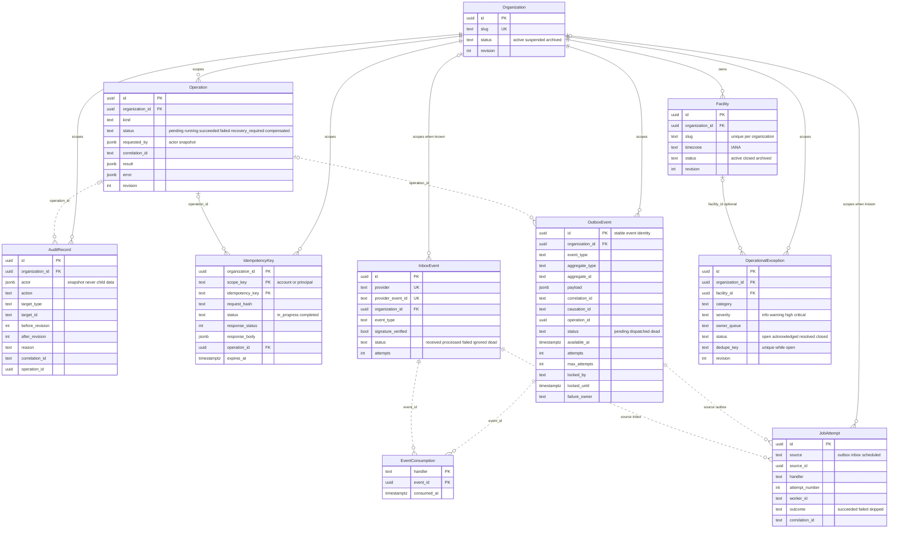

| Diagram entity       | Table                    | Notes                                                                                                                                                                        | Status       |
| -------------------- | ------------------------ | ---------------------------------------------------------------------------------------------------------------------------------------------------------------------------- | ------------ |
| Organization         | `organizations`          | §4.3; `unique (organization_id, id)` on `facilities` is the anchor for every composite foreign key                                                                           | **Verified** |
| Facility             | `facilities`             | `timezone` is the source of facility-local behaviour (SPK-SCHED-008)                                                                                                         | **Verified** |
| Operation            | `operations`             | Readable outcome of asynchronous and multi-step commands (`GET /v1/operations/{id}`); terminal statuses `succeeded`, `failed`, `compensated` (`operations.service.ts`)       | **Verified** |
| AuditRecord          | `audit_records`          | Append-only (`forbid_mutation`)                                                                                                                                              | **Verified** |
| IdempotencyKey       | `idempotency_keys`       | Primary key `(organization_id, scope_key, idempotency_key)`; same key + same `request_hash` replays, different hash conflicts (§4.9)                                         | **Verified** |
| OutboxEvent          | `outbox_events`          | Written in the business transaction; carries every §4.12 job field (organization, operation, stable identity, attempts, retry policy, correlation, failure owner)            | **Verified** |
| InboxEvent           | `inbox_events`           | `unique (provider, provider_event_id)` makes recording idempotent (§4.11 webhooks)                                                                                           | **Verified** |
| EventConsumption     | `event_consumptions`     | Primary key `(handler, event_id)`: one business effect per handler per event even when delivery repeats                                                                      | **Verified** |
| JobAttempt           | `job_attempts`           | One row per handler run with worker id and outcome                                                                                                                           | **Verified** |
| OperationalException | `operational_exceptions` | Powers the Today workspace (SPK-UX-006); closing it never resolves the underlying record; partial unique index on `(organization_id, dedupe_key)` while open or acknowledged | **Verified** |

### 4.2 Identity (`0100_identity_core.sql`, `packages/db/src/schema/identity.ts`)

**Verified** (`apps/api/src/modules/identity/__tests__/*.spec.ts`, `identity.machines.spec.ts`). Authority is only an unrevoked, unsuspended, currently effective `access_grants` row on an active relationship (SPK-IAM-003); households never confer authority (§4.5).

```mermaid
erDiagram
    Organization ||--o{ Person : "scopes"
    Person ||--o{ ContactPoint : "person_id"
    Person o|--o{ Account : "person_id nullable one active"
    Person o|--o{ Person : "merged_into_person_id"
    Household ||--o{ HouseholdMembership : "household_id"
    Person ||--o{ HouseholdMembership : "person_id grouping only"
    Person ||--o{ Relationship : "actor_person_id"
    Person ||--o{ Relationship : "subject_person_id"
    Relationship ||--o{ AccessGrant : "relationship_id same two people"
    AccessReview o|--o{ AccessGrant : "suspended_by_review_id"
    Person ||--o{ Invitation : "scope_person_id optional"
    Household o|--o{ Invitation : "scope_household_id optional"
    Person o|--o{ Invitation : "recipient_person_id optional"
    Person ||--o{ Claim : "subject_person_id"
    Account o|--o{ Claim : "accepted_by_account_id"
    Person ||--o{ StaffMembership : "person_id"
    Person ||--o{ AccessReview : "subject_person_id"
    AccessReview ||--o{ AccessReviewDecision : "review_id append-only"
    Person ||--o{ DuplicateCandidate : "person_a_id person_b_id a lt b"
    DuplicateCandidate o|--o{ PersonMerge : "candidate_id"
    Person ||--o{ PersonMerge : "survivor_person_id merged_person_id"
    Operation o|--o{ PersonMerge : "operation_id"

    Person {
        uuid id PK
        uuid organization_id FK
        text kind "adult child"
        date date_of_birth "minimized child data"
        text status "active inactive merged"
        uuid merged_into_person_id FK
        text source "staff self_service import"
        jsonb created_by "actor snapshot"
        int revision
    }
    ContactPoint {
        uuid id PK
        uuid person_id FK
        text kind "email phone"
        text value
        bool is_primary "one per kind"
        timestamptz verified_at "verified primary unique per org"
    }
    Account {
        uuid id PK
        text issuer UK
        text subject UK
        uuid person_id FK "nullable until claimed"
        text status "active disabled"
        int revision
    }
    Household {
        uuid id PK
        uuid organization_id FK
        text name
        int revision
    }
    HouseholdMembership {
        uuid id PK
        uuid household_id FK
        uuid person_id FK
        text label
    }
    Relationship {
        uuid id PK
        uuid actor_person_id FK
        uuid subject_person_id FK
        text kind "guardian delegate caregiver self_managed"
        text status "active suspended ended"
        timestamptz effective_from
        timestamptz effective_to
        text source
        int revision
    }
    AccessGrant {
        uuid id PK
        uuid relationship_id FK "deferred 4-column FK"
        uuid actor_person_id FK
        uuid subject_person_id FK
        text permission "view register pay receive_messages complete_forms collect"
        timestamptz effective_from "GiST exclusion while unrevoked"
        timestamptz effective_to
        timestamptz revoked_at
        timestamptz suspended_at
        uuid suspended_by_review_id FK
        int revision
    }
    Invitation {
        uuid id PK
        text scope_type "person household"
        text relationship_kind
        text_array requested_permissions
        text_array granted_permissions
        text token_hash UK
        text status "pending accepted revoked expired"
        timestamptz expires_at
        int revision
    }
    Claim {
        uuid id PK
        uuid subject_person_id FK
        text kind "self guardian"
        text_array requested_permissions
        text token_hash UK
        text status "pending accepted revoked expired"
        timestamptz expires_at
        int revision
    }
    StaffMembership {
        uuid id PK
        uuid person_id FK
        text_array roles "StaffRole vocabulary"
        uuid_array facility_ids "empty means every facility"
        text status "active ended"
        timestamptz effective_from
        timestamptz effective_to
        int revision
    }
    AccessReview {
        uuid id PK
        uuid subject_person_id FK
        text owner_role "general_manager system_administrator support_operator"
        text status "open escalated decided closed"
        jsonb parties
        jsonb evidence
        timestamptz effective_from
        timestamptz effective_to
        int revision
    }
    AccessReviewDecision {
        uuid id PK
        uuid review_id FK
        int sequence "unique per review"
        text kind "restrict lift escalate decide close note reassign"
        uuid_array affected_grant_ids
    }
    DuplicateCandidate {
        uuid id PK
        uuid person_a_id FK
        uuid person_b_id FK
        int score "0 to 100"
        text status "open merged dismissed"
        int revision
    }
    PersonMerge {
        uuid id PK
        uuid survivor_person_id FK
        uuid merged_person_id FK "merged at most once"
        uuid candidate_id FK
        jsonb moved
        uuid operation_id FK
    }
```

| Diagram entity                     | Table                                       | Key integrity rule                                                                                                                                                           | Status       |
| ---------------------------------- | ------------------------------------------- | ---------------------------------------------------------------------------------------------------------------------------------------------------------------------------- | ------------ |
| Person                             | `persons`                                   | `(status = 'merged') = (merged_into_person_id is not null)`; a merged person keeps its row so history stays reachable (SPK-IAM-007)                                          | **Verified** |
| ContactPoint                       | `contact_points`                            | One primary per kind per person; a verified primary identifier is unique per organization (`contact_points_verified_identifier_idx`)                                         | **Verified** |
| Account                            | `accounts`                                  | `unique (issuer, subject)`; `accounts_one_active_per_person_idx`; recovery relinks the same row and never touches grants (SPK-AT-025)                                        | **Verified** |
| Household, HouseholdMembership     | `households`, `household_memberships`       | Grouping only; never consulted by any authority check (§4.5)                                                                                                                 | **Verified** |
| Relationship                       | `relationships`                             | `relationships_live_idx`: one live row per (actor, subject, kind); `self_managed` only when actor = subject                                                                  | **Verified** |
| AccessGrant                        | `access_grants`                             | One row per permission; four-column deferred FK to the relationship; GiST exclusion forbids overlapping unrevoked grants for one permission; revoke and suspend keep the row | **Verified** |
| Invitation                         | `invitations`                               | SPK-IAM-004 fields; only the token hash is stored; acceptance grants only what the inviter still holds (`invitations.spec.ts`)                                               | **Verified** |
| Claim                              | `claims`                                    | SPK-IAM-002; `self` claims carry no permissions, `guardian` claims at least one                                                                                              | **Verified** |
| StaffMembership                    | `staff_memberships`                         | Staff authority comes only from here, time-bounded; roles limited to the `StaffRole` vocabulary (`packages/contracts/src/principal.ts`)                                      | **Verified** |
| AccessReview, AccessReviewDecision | `access_reviews`, `access_review_decisions` | SPK-IAM-005; decisions are append-only; a `restrict` decision suspends grants without deleting them                                                                          | **Verified** |
| DuplicateCandidate, PersonMerge    | `duplicate_candidates`, `person_merges`     | Canonical pair (`person_a_id < person_b_id`); a merge is an append-only fact; `person_merges_merged_once_idx`                                                                | **Verified** |

### 4.3 Scheduling (`0300_scheduling_core.sql`, `packages/db/src/schema/scheduling.ts`)

**Verified** (`apps/api/src/modules/scheduling/__tests__/*.spec.ts`, `time/recurrence.spec.ts`). Overlap between resources is expressed only through shared conflict units; `reservation_units_no_overlap` is the database guarantee of §4.7 invariant 4.

```mermaid
erDiagram
    Facility ||--o{ Resource : "facility_id"
    Resource o|--o{ Resource : "parent_resource_id subdivision"
    Facility ||--o{ ResourceConfiguration : "facility_id"
    ResourceConfiguration ||--o{ ResourceConfigurationMember : "configuration_id"
    Resource ||--o{ ResourceConfigurationMember : "resource_id"
    Facility ||--o{ ConflictUnit : "facility_id"
    Resource ||--o{ ResourceConflictUnit : "resource_id"
    ConflictUnit ||--o{ ResourceConflictUnit : "conflict_unit_id"
    Facility ||--o{ OperatingHours : "facility_id"
    Resource o|--o{ OperatingHours : "resource_id null means facility"
    Facility ||--o{ Closure : "facility_id"
    Resource o|--o{ Closure : "resource_id null means facility"
    Facility ||--o{ EventSeries : "facility_id"
    EventSeries o|--o{ Event : "series_id occurrence_index unique"
    Facility ||--o{ Event : "facility_id"
    Event ||--o{ Reservation : "event_id"
    Resource ||--o{ Reservation : "resource_id"
    Reservation ||--o{ ReservationUnit : "reservation_id"
    ConflictUnit ||--o{ ReservationUnit : "conflict_unit_id GiST exclusion"
    Event ||--o{ ReservationUnit : "event_id"
    Event ||--o{ EventCommitment : "event_id party overlap exclusion"
    Facility ||--o{ ScheduleDraft : "facility_id"
    ScheduleDraft ||--o{ DraftChange : "draft_id"
    Event o|--o{ DraftChange : "target_event_id"
    ScheduleDraft ||--o{ Publication : "draft_id append-only"
    Facility ||--o{ Publication : "facility_id"
    Operation o|..o{ Publication : "operation_id"

    Resource {
        uuid id PK
        uuid facility_id FK
        text kind "pitch subdivision room other"
        text name "unique per facility"
        uuid parent_resource_id FK
        text_array compatible_formats
        int default_setup_minutes
        int default_cleanup_minutes
        text status "active restricted closed"
        int revision
    }
    ResourceConfiguration {
        uuid id PK
        uuid facility_id FK
        text name "unique per facility"
        bool active
        int revision
    }
    ResourceConfigurationMember {
        uuid configuration_id PK
        uuid resource_id PK
    }
    ConflictUnit {
        uuid id PK
        uuid facility_id FK
        text name "unique per facility"
    }
    ResourceConflictUnit {
        uuid resource_id PK
        uuid conflict_unit_id PK
    }
    OperatingHours {
        uuid id PK
        uuid facility_id FK
        uuid resource_id FK
        smallint weekday "0 Sunday to 6 Saturday"
        time opens_at "facility local"
        time closes_at
    }
    Closure {
        uuid id PK
        uuid facility_id FK
        uuid resource_id FK
        tstzrange during
        text source "manual maintenance holiday"
        text status "pending active lifted withdrawn"
        jsonb impact
        jsonb resolution
        int revision
    }
    EventSeries {
        uuid id PK
        uuid facility_id FK
        text kind
        text timezone "IANA"
        jsonb recurrence
        time local_start_time
        text nonexistent_policy "shift_forward skip"
        text ambiguous_policy "first second"
        text status "active ended"
        int revision
    }
    Event {
        uuid id PK
        uuid facility_id FK
        text kind "game practice session rental party pickup maintenance block"
        uuid series_id FK
        int occurrence_index
        timestamptz scheduled_start "UTC"
        timestamptz scheduled_end
        text timezone "IANA copied from facility"
        text dst_resolution "exact shifted_forward first second"
        text status "draft published canceled"
        int published_revision
        text source_type "owning record fixture session rental"
        uuid source_id
        int revision
    }
    Reservation {
        uuid id PK
        uuid event_id FK
        uuid resource_id FK
        tstzrange occupied "scheduled plus buffers"
        text status "active released"
    }
    ReservationUnit {
        uuid id PK
        uuid reservation_id FK
        uuid event_id FK
        uuid conflict_unit_id FK
        tstzrange occupied "exclusion while active"
        text status "active released"
    }
    EventCommitment {
        uuid id PK
        uuid event_id FK
        text party_type "team person equipment"
        uuid party_id "cross-module reference"
        text role
        tstzrange occupied "exclusion per party while active"
        text status "active released"
    }
    ScheduleDraft {
        uuid id PK
        uuid facility_id FK
        jsonb base_revision "captured event revisions"
        jsonb author "actor snapshot"
        text status "editing validated publishing published failed discarded"
        jsonb validation_results
        uuid publication_group_id
        int revision
    }
    DraftChange {
        uuid id PK
        uuid draft_id FK
        int sequence "unique per draft"
        text kind "create move cancel resize resource_change"
        uuid target_event_id FK
        int base_event_revision
        jsonb proposed
    }
    Publication {
        uuid id PK
        uuid draft_id FK
        uuid facility_id FK
        jsonb actor
        timestamptz committed_at
        uuid_array event_ids
        uuid_array notice_event_ids
        jsonb summary "changes and remaining obligations"
        uuid operation_id
    }
```

| Diagram entity                                     | Table                                                       | Key integrity rule                                                                                                                                                                                               | Status       |
| -------------------------------------------------- | ----------------------------------------------------------- | ---------------------------------------------------------------------------------------------------------------------------------------------------------------------------------------------------------------- | ------------ |
| Resource                                           | `resources`                                                 | A subdivision always has a parent (`kind <> 'subdivision' or parent_resource_id is not null`); SPK-SCHED-001 attributes                                                                                          | **Verified** |
| ResourceConfiguration, ResourceConfigurationMember | `resource_configurations`, `resource_configuration_members` | Names the set of resources that may operate simultaneously (SPK-SCHED-002)                                                                                                                                       | **Verified** |
| ConflictUnit, ResourceConflictUnit                 | `conflict_units`, `resource_conflict_units`                 | A whole pitch maps to all units of its subdivisions; a subdivision maps to its own (SPK-SCHED-002)                                                                                                               | **Verified** |
| OperatingHours                                     | `operating_hours`                                           | Facility-local windows per weekday; resource windows override facility windows                                                                                                                                   | **Verified** |
| Closure                                            | `closures`                                                  | `pending → active → lifted`, `withdrawn` from pending (`ClosureMachine`); impact preview names games, programs, rentals, parties (SPK-SCHED-009)                                                                 | **Verified** |
| EventSeries, Event                                 | `event_series`, `events`                                    | Instants in UTC with the facility zone (SPK-SCHED-008); `events_series_occurrence_idx` gives each occurrence a stable identity (SPK-SCHED-007); `status <> 'published' or published_revision is not null`        | **Verified** |
| Reservation, ReservationUnit                       | `reservations`, `reservation_units`                         | `occupied` = scheduled interval plus setup and cleanup buffers (SPK-SCHED-003); `reservation_units_no_overlap` GiST exclusion on `(organization_id, conflict_unit_id, occupied)` while active (§4.7 invariant 4) | **Verified** |
| EventCommitment                                    | `event_commitments`                                         | `event_commitments_no_overlap` on `(organization_id, party_type, party_id, occupied)` while active: teams, people and equipment cannot be double-booked (SPK-SCHED-004)                                          | **Verified** |
| ScheduleDraft, DraftChange                         | `schedule_drafts`, `draft_changes`                          | SPK-SCHED-005 fields; autosave guarded by the draft revision; `create` is the only change kind without a target event                                                                                            | **Verified** |
| Publication                                        | `publications`                                              | Append-only publication group (§4.7 invariant 9); carries `operation_id` of the `scheduling.publish_schedule` operation and the remaining fixture obligations (SPK-FIX-002)                                      | **Verified** |

### 4.4 Catalog and policies (`0200_catalog_core.sql`, `packages/db/src/schema/catalog.ts`)

**Verified** (`apps/api/src/modules/catalog/__tests__/*.spec.ts`, `catalog.state-machines.spec.ts`, `entitlements/equivalence-key.spec.ts`, `pricing/discount-evaluator.spec.ts`). Approved policy content and pricing content are immutable (triggers `policy_versions_guard` and `price_rules_guard`); a correction is a new version. Dashed lines are references without a database foreign key: `offering_sessions.scheduling_event_id` (scheduling owns the event and migration order forbids a cross-module key) and `approvals.subject_id` (polymorphic over `subject_type`).

```mermaid
erDiagram
    Program ||--o{ Offering : "program_id"
    Facility ||--o{ Offering : "facility_id"
    Person o|--o{ Offering : "responsible_manager_person_id"
    Offering o|--o{ Offering : "copied_from_offering_id"
    PolicyVersion o|--o{ Offering : "eligibility_policy_version_id"
    PolicyVersion o|--o{ Offering : "cancellation_policy_version_id"
    EntitlementDefinition o|--o{ Offering : "entitlement_definition_id"
    Offering ||--o{ OfferingRequiredForm : "offering_id"
    PolicyVersion ||--o{ OfferingRequiredForm : "policy_version_id"
    Offering ||--o{ OfferingSession : "offering_id sequence unique"
    OfferingSession o|..o| Event : "scheduling_event_id no FK"
    Offering ||--o{ PriceRule : "offering_id one effective per instant"
    Person o|--o{ Approval : "actor_person_id"
    PolicyVersion ||..o{ Approval : "subject_type policy_version"
    Offering ||..o{ Approval : "subject_type offering_publication"
    PolicyVersion ||--o{ Acknowledgment : "policy_version_id"
    Person ||--o{ Acknowledgment : "subject_person_id"
    Person ||--o{ Acknowledgment : "signed_by_person_id never the staff recorder"
    Person o|--o{ Acknowledgment : "recorded_by_person_id"
    DiscountDefinition ||--o| DiscountRedemption : "counter with mirrored limit"
    DiscountDefinition ||--o{ DiscountRedemptionEntry : "append-only redeem and release"
    Person o|--o{ DiscountRedemptionEntry : "person_id"

    Program {
        uuid id PK
        text name "unique per organization"
        text activity_type
        text format
        jsonb age_band
        text status "draft active archived"
        int revision
    }
    PolicyVersion {
        uuid id PK
        text kind "eligibility cancellation refund discount waitlist hold approval form overpayment installment"
        text key
        int version "unique per kind and key"
        jsonb content "immutable once approved"
        timestamptz effective_from
        timestamptz effective_to
        text approval_status "draft approved retired"
        jsonb approved_by
        int revision
    }
    Approval {
        uuid id PK
        text subject_type "policy_version offering_publication"
        uuid subject_id
        text decision "approved rejected"
        jsonb actor
        uuid actor_person_id FK
        text reason
        timestamptz occurred_at
    }
    Acknowledgment {
        uuid id PK
        uuid subject_person_id FK
        uuid policy_version_id FK
        uuid signed_by_person_id FK
        text basis "self guardian"
        jsonb recorded_by "staff actor when assisted"
        text recorded_by_kind "customer staff system"
        uuid recorded_by_person_id FK
        timestamptz signed_at
        jsonb evidence "never child data"
        text status "active withdrawn"
        int revision
    }
    EntitlementDefinition {
        uuid id PK
        text name "unique per organization"
        text kind "team_entry roster_place seat session_seat camp_group_place rental_resource package_credits membership_benefit"
        jsonb scope
        text equivalence_scope "offering program program_period session none"
        jsonb equivalence_rule
        text status "active archived"
        int revision
    }
    Offering {
        uuid id PK
        uuid program_id FK
        uuid facility_id FK
        text kind "season term camp session trial makeup pickup private_coaching rental package membership"
        date starts_on
        date ends_on
        timestamptz registration_opens_at
        timestamptz registration_closes_at
        date eligibility_reference_date
        uuid eligibility_policy_version_id FK
        uuid entitlement_definition_id FK
        jsonb capacity_units
        uuid cancellation_policy_version_id FK
        uuid responsible_manager_person_id FK
        text publication_state "draft published registration_open registration_paused closed archived"
        uuid copied_from_offering_id FK
        int revision
    }
    OfferingRequiredForm {
        uuid offering_id PK
        uuid policy_version_id PK
        int sequence
    }
    OfferingSession {
        uuid id PK
        uuid offering_id FK
        int sequence
        timestamptz scheduled_start
        timestamptz scheduled_end
        uuid scheduling_event_id "no FK"
        jsonb capacity_override
        text status "scheduled canceled completed"
        int revision
    }
    PriceRule {
        uuid id PK
        uuid offering_id FK
        int version "unique per offering"
        timestamptz effective_from
        timestamptz effective_to
        bigint base_price_minor
        text currency
        jsonb charge_lines "approved taxes and fees"
        int revision
    }
    DiscountDefinition {
        uuid id PK
        text code "case-insensitive unique or null"
        text kind "promo_code automatic"
        text amount_kind "percentage fixed"
        bigint amount_value "basis points or minor units"
        text currency
        jsonb eligibility_rules
        text stacking_rule "exclusive stackable"
        int stacking_priority
        bigint cap_minor
        int redemption_limit
        int per_person_limit
        text rounding "half_up half_even down up"
        text allocation_method "proportional largest_first first_line even"
        text status "draft active retired"
        int revision
    }
    DiscountRedemption {
        uuid discount_definition_id PK
        int redemption_limit "mirrored"
        int redeemed_count "check within limit"
    }
    DiscountRedemptionEntry {
        uuid id PK
        uuid discount_definition_id FK
        text kind "redeem release"
        text reference_type
        uuid reference_id "unique per definition reference and kind"
        uuid person_id FK
        bigint amount_minor
        text currency
        jsonb actor
        timestamptz occurred_at
    }
```

| Diagram entity                 | Table                                  | Key integrity rule                                                                                                                                                                                                                                                                                                                                                                            | Status                                                                                                                                       |
| ------------------------------ | -------------------------------------- | --------------------------------------------------------------------------------------------------------------------------------------------------------------------------------------------------------------------------------------------------------------------------------------------------------------------------------------------------------------------------------------------- | -------------------------------------------------------------------------------------------------------------------------------------------- |
| Program                        | `programs`                             | Name unique per organization; `status` check lists exactly `ProgramMachine`'s states                                                                                                                                                                                                                                                                                                          | **Verified** (`programs-and-entitlements.spec.ts`; `catalog.state-machines.spec.ts`)                                                         |
| PolicyVersion                  | `policy_versions`                      | `(kind, key, version)` unique; `policy_versions_guard`: approved content, kind, key, version, title and effective start are immutable, no return to draft, retired is final; checks pair `approval_status` with `approved_at`, `approved_by` and `retired_at`                                                                                                                                 | **Verified** (`catalog-schema.spec.ts` "§4.4 PolicyVersion ..." and "§4.4: one policy version number per (kind, key)")                       |
| Approval                       | `approvals`                            | Append-only (`forbid_mutation`); `subject_type` in `policy_version`, `offering_publication`; composite foreign key to `persons` for `actor_person_id`                                                                                                                                                                                                                                         | **Verified** (`catalog-schema.spec.ts` "§4.4 Approval: approvals are append-only facts")                                                     |
| Acknowledgment                 | `acknowledgments`                      | `acknowledgments_active_idx`: one active row per `(subject_person_id, policy_version_id)`; `acknowledgments_staff_never_signer`; `basis = 'self'` exactly when the signer is the subject; composite foreign keys to `persons` and `policy_versions`                                                                                                                                           | **Verified** (`catalog-schema.spec.ts` SPK-REG-009; `policies-and-acknowledgments.spec.ts` SPK-REG-009)                                      |
| EntitlementDefinition          | `entitlement_definitions`              | Name unique per organization; eight kinds; five equivalence scopes that feed `equivalenceKey` (§4.7 invariant 2)                                                                                                                                                                                                                                                                              | **Verified** (`programs-and-entitlements.spec.ts`; `entitlements/equivalence-key.spec.ts`)                                                   |
| Offering, OfferingRequiredForm | `offerings`, `offering_required_forms` | `offerings_published_configuration_complete` (SPK-CAT-004): beyond `draft`, the registration window, eligibility and cancellation policy versions, entitlement definition, responsible manager and at least one capacity unit are required; `starts_on <= ends_on`; composite foreign keys to programs, facilities, policy versions, entitlement definitions, persons and the source offering | **Verified** (`catalog-schema.spec.ts` SPK-CAT-004 and "§4.3: an offering cannot reference another organization's ..."; `offerings.spec.ts`) |
| OfferingSession                | `offering_sessions`                    | `(offering_id, sequence)` unique; `scheduled_start < scheduled_end`; `canceled_at` set exactly when `status = 'canceled'`; `scheduling_event_id` has no foreign key                                                                                                                                                                                                                           | **Verified** (`catalog-schema.spec.ts` "§4.4 Session ..."; `offerings.spec.ts` "§4.4 Session ...")                                           |
| PriceRule                      | `price_rules`                          | `price_rules_one_effective_per_instant`: GiST exclusion on `(organization_id, offering_id, tstzrange(effective_from, effective_to, '[)'))`; `price_rules_guard` forbids every change except closing or shortening the window; `(offering_id, version)` unique; `base_price_minor >= 0` with an ISO 4217 currency (SPK-PAY-001)                                                                | **Verified** (`catalog-schema.spec.ts` SPK-PAY-001, SPK-PAY-002; `pricing.spec.ts`)                                                          |
| DiscountDefinition             | `discount_definitions`                 | `discount_definitions_code_idx` on `lower(code)`; a promo code has a code and an automatic discount has none; a percentage is at most 10000 basis points; a fixed amount carries a currency; `status` check lists `DiscountMachine`'s states                                                                                                                                                  | **Verified** (`catalog-schema.spec.ts` SPK-PAY-003; `pricing.spec.ts` SPK-PAY-003)                                                           |
| DiscountRedemption             | `discount_redemptions`                 | `discount_redemptions_within_limit`: `redeemed_count <= redemption_limit`, the database guarantee of §4.7 invariant 7                                                                                                                                                                                                                                                                         | **Verified** (`catalog-schema.spec.ts` "§4.7 invariant 7 ..."; `pricing.spec.ts` "§4.7 invariant 7 ...")                                     |
| DiscountRedemptionEntry        | `discount_redemption_entries`          | Append-only; unique `(discount_definition_id, reference_type, reference_id, kind)` so a replayed checkout never redeems or releases twice (§4.7 invariant 5)                                                                                                                                                                                                                                  | **Verified** (`catalog-schema.spec.ts` "§4.7 invariant 5 ...")                                                                               |

### 4.5 Facilities (`0900_facilities_core.sql`, `packages/db/src/schema/facilities.ts`)

**Verified** (`apps/api/src/modules/facilities/__tests__/*.spec.ts`, `facilities.state-machines.spec.ts`). A restriction names the affected physical area (a scheduling `resources` row: a whole pitch or one subdivision) and, once active, is backed by exactly one scheduling `closures` row created through the scheduling closure port (SPK-FAC-003); the facilities module never writes scheduling tables (§4.2). Release is a separate authorized act that lifts the closure (SPK-FAC-004). The dashed line is `operation_id`, a reference without a foreign key.

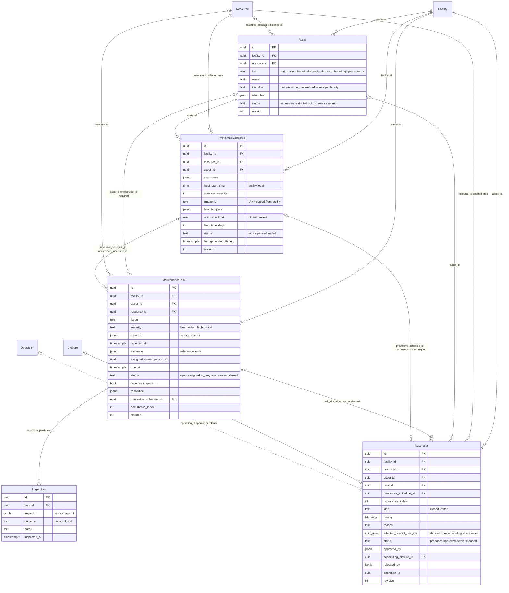

| Diagram entity     | Table                  | Key integrity rule                                                                                                                                                                                                                                                                                                                                                                                                                                                        | Status                                                                                                                                            |
| ------------------ | ---------------------- | ------------------------------------------------------------------------------------------------------------------------------------------------------------------------------------------------------------------------------------------------------------------------------------------------------------------------------------------------------------------------------------------------------------------------------------------------------------------------- | ------------------------------------------------------------------------------------------------------------------------------------------------- |
| Asset              | `assets`               | `assets_identifier_idx`: an identifier names at most one non-retired asset per facility (SPK-FAC-001); composite foreign keys to `facilities` and `resources`; `status` check lists `AssetMachine`'s states                                                                                                                                                                                                                                                               | **Verified** (`schema-invariants.spec.ts` SPK-FAC-001; `maintenance-tasks.spec.ts` SPK-FAC-001)                                                   |
| PreventiveSchedule | `preventive_schedules` | Recurrence in facility-local time with the facility zone copied onto the row (SPK-SCHED-008); `status` check lists `PreventiveScheduleMachine`'s states                                                                                                                                                                                                                                                                                                                   | **Verified** (`preventive-schedules.spec.ts`; `facilities.state-machines.spec.ts`)                                                                |
| MaintenanceTask    | `maintenance_tasks`    | `asset_id` or `resource_id` required (SPK-FAC-002); `assigned` requires an owner; `resolved` and `closed` require a resolution and their instants; `maintenance_tasks_occurrence_idx`: one task per preventive occurrence; `status` check lists `MaintenanceTaskMachine`'s states                                                                                                                                                                                         | **Verified** (`schema-invariants.spec.ts` SPK-FAC-002, SPK-FAC-005, "check constraints list exactly the lifecycle states (§4.6)")                 |
| Inspection         | `inspections`          | Append-only (`forbid_mutation`); the latest outcome decides whether a release is permitted (SPK-FAC-004)                                                                                                                                                                                                                                                                                                                                                                  | **Verified** (`schema-invariants.spec.ts` "inspections are append-only observations"; `restrictions.spec.ts` SPK-AT-021)                          |
| Restriction        | `restrictions`         | Approval, activation and release facts are check-constrained to the state; `active` and `released` require `scheduling_closure_id` (composite foreign key to `closures`); `restrictions_closure_idx`: one closure backs at most one restriction; `restrictions_open_task_idx`: one unreleased restriction per task; `restrictions_occurrence_idx`; GiST index on `(resource_id, during)` for approved and active rows; `status` check lists `RestrictionMachine`'s states | **Verified** (`schema-invariants.spec.ts` SPK-FAC-003/004, SPK-FAC-002, SPK-FAC-005; `restrictions.spec.ts`; `facilities.state-machines.spec.ts`) |

## 5. Proposed diagrams: the §4.4 entities not yet in a migration

Every entity in this section is **Proposed**. The relationships are derived from the requirement text cited in section 3. Where a Proposed entity points at a Verified one (Person, Facility, Resource, Event, Closure, Operation, Offering, OfferingSession, EntitlementDefinition, PolicyVersion, PriceRule, Acknowledgment), the reference is by `(organization_id, id)` composite foreign key, following the convention of section 2. Catalog and policies (section 4.4) and facilities (section 4.5) left this section on 2026-10-24 when their migrations landed.

### 5.1 Competition, matches and discipline

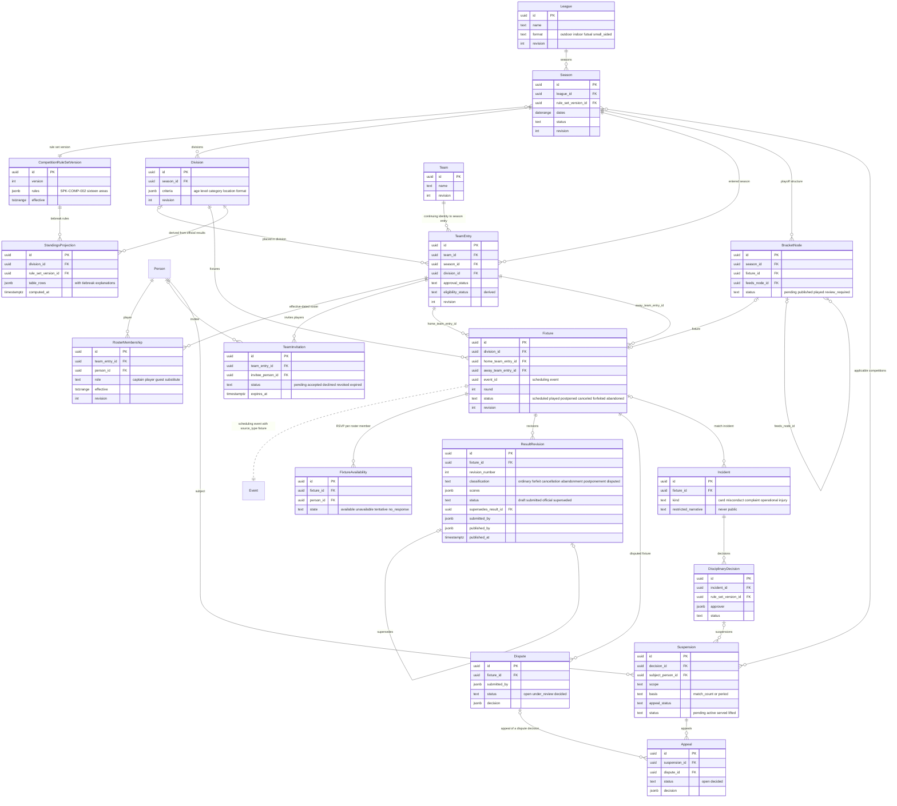

| Entity group                                              | Status       | Pending inputs (owner from §6.6)                                                                                              |
| --------------------------------------------------------- | ------------ | ----------------------------------------------------------------------------------------------------------------------------- |
| League, Season, Division, CompetitionRuleSetVersion       | **Proposed** | Soccer formats and competition rules: League manager (DEC-002)                                                                |
| Team, TeamEntry, RosterMembership, TeamInvitation         | **Proposed** | Roster limits, guest and substitute rules: League manager (DEC-002); team billing model: Finance and league manager (DEC-008) |
| Fixture, FixtureAvailability                              | **Proposed** | Allowed start times, rest, byes, playoff structure (SPK-FIX-001): League manager (DEC-002), Operations (DEC-001)              |
| ResultRevision, StandingsProjection, BracketNode, Dispute | **Proposed** | Result publication authority (DEC-065) and protest deadlines: League manager (DEC-002)                                        |
| Incident, DisciplinaryDecision, Suspension, Appeal        | **Proposed** | Discipline and appeals: League manager/operator (DEC-010)                                                                     |

### 5.2 Enrollment: participation and capacity

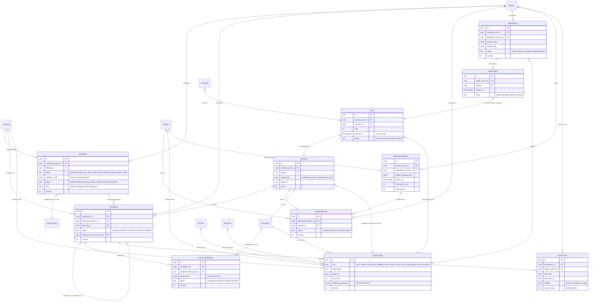

| Entity group                                              | Status       | Proposed defaults and pending inputs (owner from §6.6)                                                                                                                                                                                                                                           |
| --------------------------------------------------------- | ------------ | ------------------------------------------------------------------------------------------------------------------------------------------------------------------------------------------------------------------------------------------------------------------------------------------------ |
| Application, Enrollment, PlacementRequest, SessionBooking | **Proposed** | Which offerings need human approval and whether approval reserves capacity (SPK-REG-007, **Proposed** default: approval before capturing a new payment): Product and operations (DEC-028); youth eligibility: Program manager (DEC-003)                                                          |
| CapacityPool, Hold, Allocation                            | **Proposed** | Hold starting duration ten minutes (SPK-REG-006, **Proposed** default, DEC-027); the database constraint that `active holds + allocations <= limit_units` is the mechanism for §4.7 invariant 3 and SPK-AT-005 (**Proposed**, following the exclusion-constraint pattern verified in scheduling) |
| WaitlistEntry, WaitlistOffer                              | **Proposed** | Priority basis and offer expiry: Product and operations (DEC-006)                                                                                                                                                                                                                                |
| MakeupEntitlement, Assessment                             | **Proposed** | Redemption limits and assessment templates: Program manager (DEC-003)                                                                                                                                                                                                                            |

### 5.3 Finance and accounting support

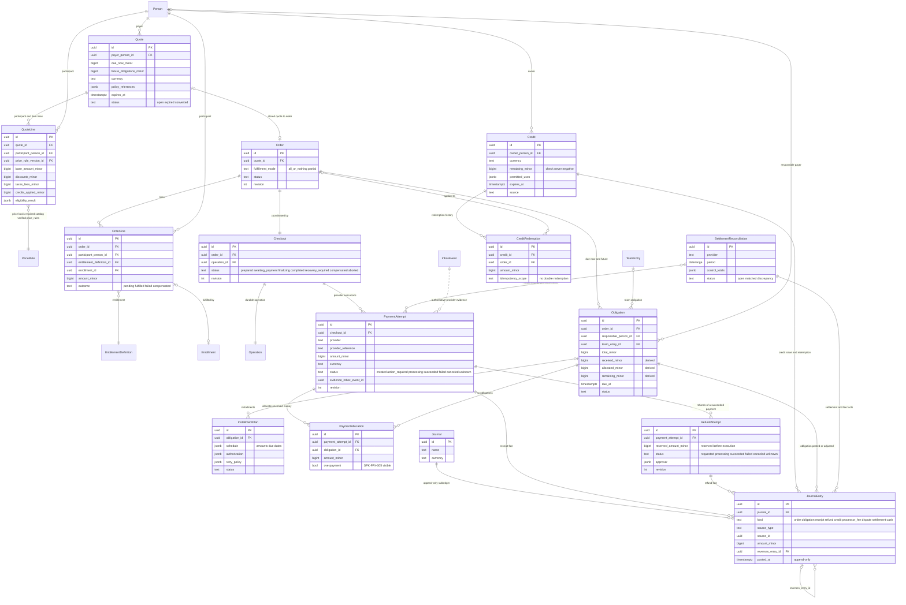

| Entity group                                    | Status       | Proposed defaults and pending inputs (owner from §6.6)                                                                                                                                                                                                                                                                 |
| ----------------------------------------------- | ------------ | ---------------------------------------------------------------------------------------------------------------------------------------------------------------------------------------------------------------------------------------------------------------------------------------------------------------------- |
| Quote, QuoteLine, Order, OrderLine, Checkout    | **Proposed** | Prices, taxes, discounts, rounding: Finance (DEC-007); all-or-nothing basket fulfillment (**Proposed** default, DEC-026); approval before capture (**Proposed** default, DEC-028). `QuoteLine` is not in §4.4; it is added so each basket line retains its own price and eligibility result (SPK-REG-004, SPK-PAY-002) |
| Obligation, InstallmentPlan, PaymentAllocation  | **Proposed** | Team liability, installments, overpayments: Finance and league manager (DEC-008); installments are a conditional capability: Product owner (DEC-016)                                                                                                                                                                   |
| PaymentAttempt, RefundAttempt                   | **Proposed** | Payment processor and merchant arrangement: Technical lead/account owners (DEC-019); refund rules: Finance (DEC-009). The `unknown` state and its reconciliation are modelled by the **Verified** machines (sections 6.6, 6.7); provider evidence arrives through the **Verified** `inbox_events` table                |
| Credit, CreditRedemption                        | **Proposed** | Credit issuance and expiry: Finance (DEC-009). `CreditRedemption` is not in §4.4; it is the "redemption history" of SPK-PAY-009 and the row whose uniqueness prevents double redemption (§4.7 invariant 7)                                                                                                             |
| Journal, JournalEntry, SettlementReconciliation | **Proposed** | Accounting mapping is a conditional capability (§3.16): Product owner (DEC-016); reconciliation owner per provider (§5.1): Technical lead/account owners (DEC-019)                                                                                                                                                     |

### 5.4 Workforce, entry, communications, support and migration

```mermaid
erDiagram
    Person ||--o{ Availability : "declared availability"
    Person ||--o{ Qualification : "evidence where required"
    Person ||--o{ Assignment : "official or coach"
    Event ||--o{ Assignment : "fixture or session event"
    Assignment ||..|| EventCommitment : "party_type person overlap guard"
    Assignment ||--o{ FeeSubmission : "approved hours or fees"
    Assignment o|--o| Assignment : "replacement_of_assignment_id"

    Facility ||--o{ Visit : "arrival"
    Person ||--o{ Visit : "visitor or participant"
    Visit o|--o| Departure : "departure"
    Visit ||--o{ AttendanceObservation : "check-in and observed attendance"
    Event ||--o{ AttendanceObservation : "session"
    AttendanceObservation o|--o{ AttendanceObservation : "corrects_observation_id"
    Visit o|--o{ ReleaseRecord : "supervised release"
    Person ||--o{ ReleaseRecord : "child"
    Person ||--o{ ReleaseRecord : "collecting person"
    Person ||--o{ Pass : "opaque reference"

    OutboxEvent ||..o{ Notification : "trigger event"
    Person ||--o{ Notification : "recipient from current permissions"
    Person o|--o{ Notification : "subject person"
    Notification ||--o{ DeliveryAttempt : "channel attempts"
    Notification o|--o{ CommsAcknowledgment : "acknowledged"
    Person ||--o{ Preference : "essential vs promotional per channel"
    Audience ||--o{ Notification : "staff composed send"
    Person ||--o{ CalendarFeedAuthorization : "revocable feed token"

    Person o|--o{ Case : "customer"
    Case ||--o{ CaseLink : "related records"
    OperationalException o|--o{ Case : "escalated exception"

    ImportBatch ||--o{ ExternalMapping : "source id to internal record"
    ImportBatch ||--o{ ImportException : "review queue"
    AuthorityAssignment }o--|| Facility : "scope"

    Availability {
        uuid id PK
        uuid person_id FK
        tstzrange window
        text kind "available unavailable"
    }
    Qualification {
        uuid id PK
        uuid person_id FK
        text kind
        jsonb evidence
        daterange valid
    }
    Assignment {
        uuid id PK
        uuid person_id FK
        uuid event_id FK
        text role "referee assistant coach"
        text status "proposed offered accepted declined withdrawn completed"
        tstzrange access_window "time-bounded access"
        uuid replacement_of_assignment_id FK
        int revision
    }
    FeeSubmission {
        uuid id PK
        uuid assignment_id FK
        text rate_basis
        bigint submitted_amount_minor
        text currency
        jsonb approver
        jsonb adjustments
        text export_status
    }
    Visit {
        uuid id PK
        uuid facility_id FK
        uuid person_id FK
        text category "participant guardian spectator"
        timestamptz arrived_at
    }
    Departure {
        uuid id PK
        uuid visit_id FK
        timestamptz departed_at
    }
    AttendanceObservation {
        uuid id PK
        uuid visit_id FK
        uuid event_id FK
        uuid person_id FK
        text kind "check_in present absent late"
        timestamptz observed_at
        timestamptz received_at "offline queue"
        uuid snapshot_reference "roster snapshot"
        uuid corrects_observation_id FK
        jsonb actor
        text reason
    }
    ReleaseRecord {
        uuid id PK
        uuid visit_id FK
        uuid child_person_id FK
        uuid collecting_person_id FK
        text verification_outcome "authorized denied escalated manual_outage"
        jsonb staff_actor
        text release_outcome
    }
    Pass {
        uuid id PK
        uuid person_id FK
        text opaque_reference UK
        text status "active revoked"
    }
    Notification {
        uuid id PK
        uuid trigger_event_id "outbox event id"
        uuid recipient_person_id FK
        uuid subject_person_id FK
        text trigger "SPK-COMMS-002 trigger"
        jsonb old_details
        jsonb new_details
        bool essential
        text status "queued superseded sent"
    }
    DeliveryAttempt {
        uuid id PK
        uuid notification_id FK
        text channel "in_app push email sms"
        text provider
        text provider_reference
        text state "queued provider_accepted delivered failed unknown read"
        timestamptz authority_rechecked_at "SPK-COMMS-003"
    }
    CommsAcknowledgment {
        uuid id PK
        uuid notification_id FK
        timestamptz acknowledged_at
    }
    Preference {
        uuid id PK
        uuid person_id FK
        text category "essential promotional"
        text channel
        bool opted_in
    }
    Audience {
        uuid id PK
        jsonb criteria
        jsonb composer "staff actor"
        int recipient_count "previewed"
        text status "draft previewed confirmed"
    }
    CalendarFeedAuthorization {
        uuid id PK
        uuid person_id FK
        text token_hash UK
        text status "active revoked"
    }
    Case {
        uuid id PK
        uuid customer_person_id FK
        uuid exception_id FK
        jsonb owner
        text category
        text status "open resolved closed"
        jsonb resolution
    }
    CaseLink {
        uuid id PK
        uuid case_id FK
        text target_type
        uuid target_id
    }
    ImportBatch {
        uuid id PK
        text source
        text checksum
        text transformation_version
        jsonb row_outcomes
        text status
    }
    ExternalMapping {
        uuid id PK
        uuid import_batch_id FK
        text source_system
        text external_id
        text target_type
        uuid target_id
        jsonb provenance
    }
    ImportException {
        uuid id PK
        uuid import_batch_id FK
        text category "ambiguous_relationship ambiguous_balance validation"
        jsonb review_decision
        text status "open decided"
    }
    AuthorityAssignment {
        uuid id PK
        text record_category
        uuid facility_id FK
        text writer "sportspark legacy"
        tstzrange effective
    }
```

| Entity group                                                                                        | Status       | Pending inputs (owner from §6.6)                                                                                                                                                                                                                                                                                  |
| --------------------------------------------------------------------------------------------------- | ------------ | ----------------------------------------------------------------------------------------------------------------------------------------------------------------------------------------------------------------------------------------------------------------------------------------------------------------- |
| Availability, Qualification, Assignment, FeeSubmission                                              | **Proposed** | Official qualifications and fees: Operations/finance (DEC-011)                                                                                                                                                                                                                                                    |
| Visit, Departure, AttendanceObservation, ReleaseRecord, Pass                                        | **Proposed** | Pickup and outage procedure: Operations (DEC-005); maximum offline roster age two hours (§4.15, **Proposed** default, DEC-033)                                                                                                                                                                                    |
| Notification, DeliveryAttempt, CommsAcknowledgment, Preference, Audience, CalendarFeedAuthorization | **Proposed** | Public information and communication policy: Operator/privacy owner (DEC-012, DEC-062); messaging providers: Technical lead/account owners (DEC-020). `CommsAcknowledgment` is the §4.4 Communications "Acknowledgment", renamed in the diagram to keep it distinct from the policy Acknowledgment of section 4.4 |
| Case, CaseLink                                                                                      | **Proposed** | Support, workload, service objectives: Technical lead/operator (DEC-015)                                                                                                                                                                                                                                          |
| ImportBatch, ExternalMapping, ImportException, AuthorityAssignment                                  | **Proposed** | Migration scope and writer authority: Migration owner/operator (DEC-014)                                                                                                                                                                                                                                          |

### 5.5 Cross-module spine

The chains the specification singles out, end to end, with the module boundary at each hop. A module never writes another module's table (§4.2, `CLAUDE.md`); cross-module links are composite foreign keys to the other module's `(organization_id, id)` or, for scheduling events, the `source_type`/`source_id` pair and `event_commitments.party_id` that scheduling owns (**Verified** columns).

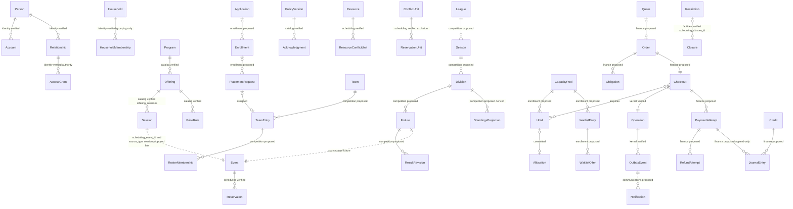

## 6. Lifecycles (§4.6), exactly as defined in `packages/contracts/src/state-machines.ts`

All ten machines are **Verified**: they are defined in `packages/contracts/src/state-machines.ts` and tested by `packages/contracts/src/state-machines.spec.ts` ("every machine has an initial state, terminal states with no exits, and reachable states"; "holds have exactly one terminal outcome"; "unknown payment outcomes resolve only to authoritative terminal states"; "checkout keeps provider success with local failure visible as recovery_required"; "results never go backwards from official"). State and event names below are the code identifiers, not paraphrases. The entities that carry these lifecycles (section 3) are **Proposed** until their tables exist; the contract is the single source of truth for the services, the database check constraints and this document (`CLAUDE.md` "Data rules").

Reading the diagrams: `[*] -->` marks the `initial` state; a transition `--> [*]` marks a `terminal` state (no exits); each arrow label is the event name passed to `Machine.next(from, event)`.

### 6.1 Application (`ApplicationMachine`)

Initial `draft`; terminal `accepted`, `declined`, `withdrawn`. Carried by the enrollment Application (SPK-REG-003).

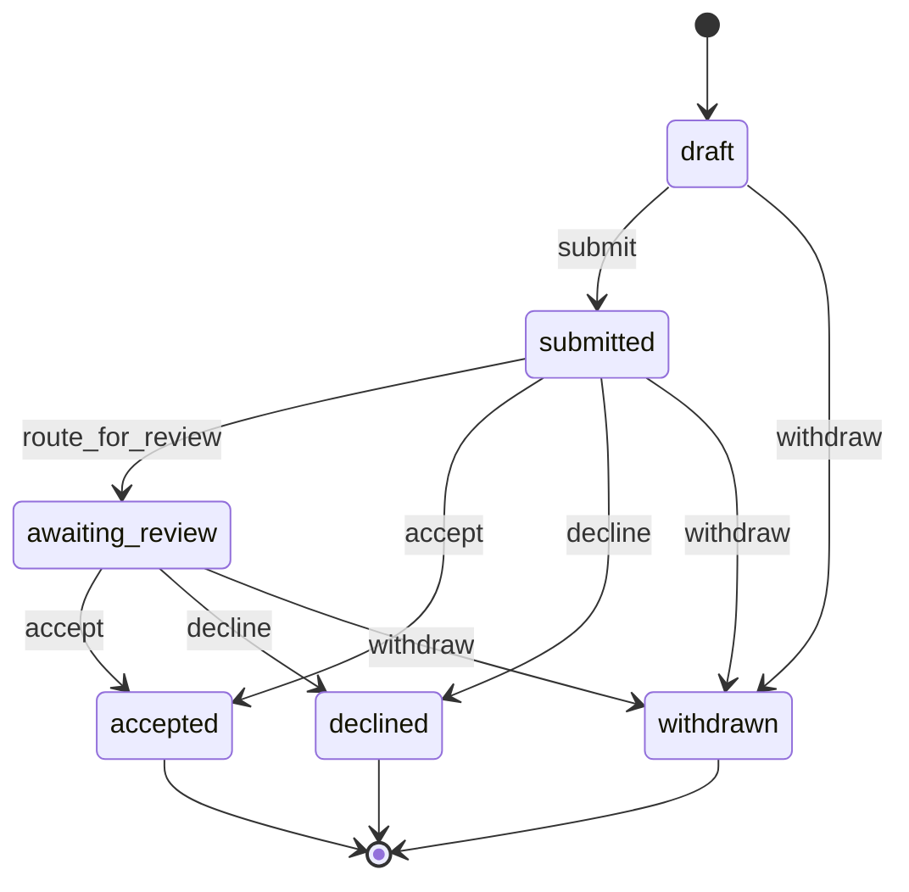

### 6.2 Enrollment (`EnrollmentMachine`)

Initial `pending`; terminal `canceled`, `transferred`, `completed`. Confirmation and waitlisting are separate records (§4.5); a transfer ends this enrollment and links the new one (SPK-REG-010).

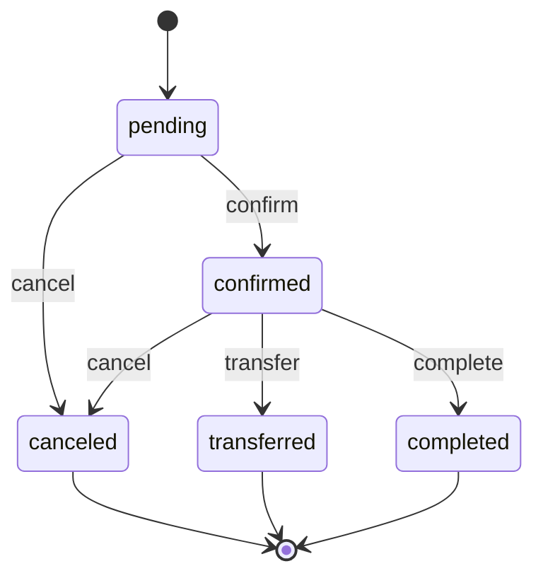

### 6.3 Placement (`PlacementMachine`)

Initial `unassigned`; terminal `released`. A proposal reserves nothing (SPK-PLACE-003); `assign` checks capacity and eligibility at commitment.

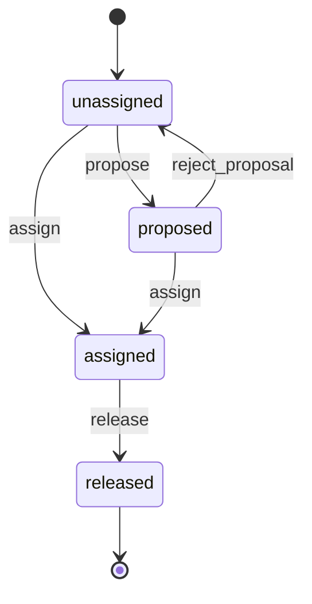

### 6.4 Hold (`HoldMachine`)

Initial `active`; terminal `committed`, `released`, `expired`. Exactly one terminal outcome (SPK-REG-006); the server controls expiry.

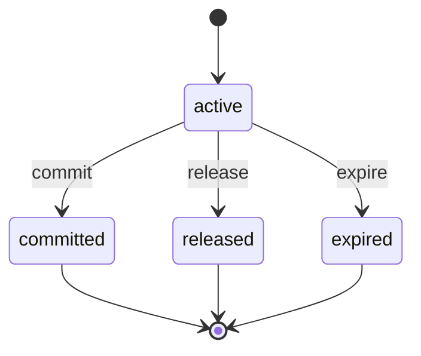

### 6.5 Session booking (`SessionBookingMachine`)

Initial `pending`; terminal `canceled`, `expired`. Note that `confirmed` is not terminal: a confirmed booking can still be canceled.

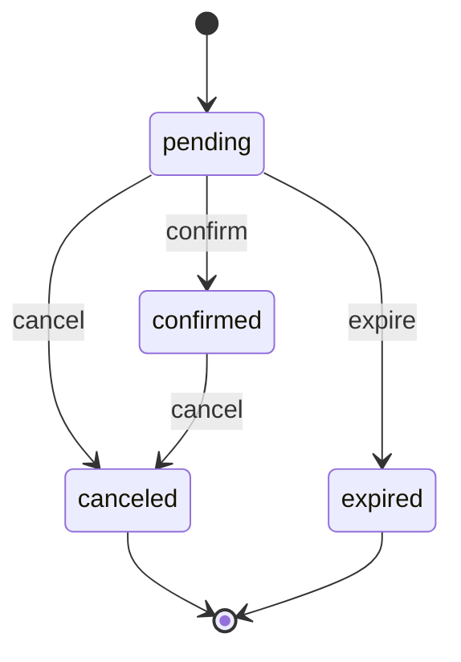

### 6.6 Payment attempt (`PaymentAttemptMachine`)

Initial `created`; terminal `succeeded`, `failed`, `canceled`. `unknown` is not terminal: it is resolved only by authoritative reconciliation evidence (SPK-PAY-007), never by a timeout.

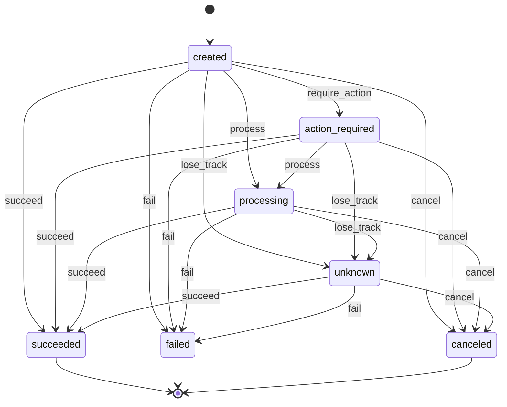

### 6.7 Refund (`RefundMachine`)

Initial `requested`; terminal `succeeded`, `failed`, `canceled`. An unknown external result retains its reservation until reconciliation (SPK-PAY-008); `unknown` cannot be canceled.

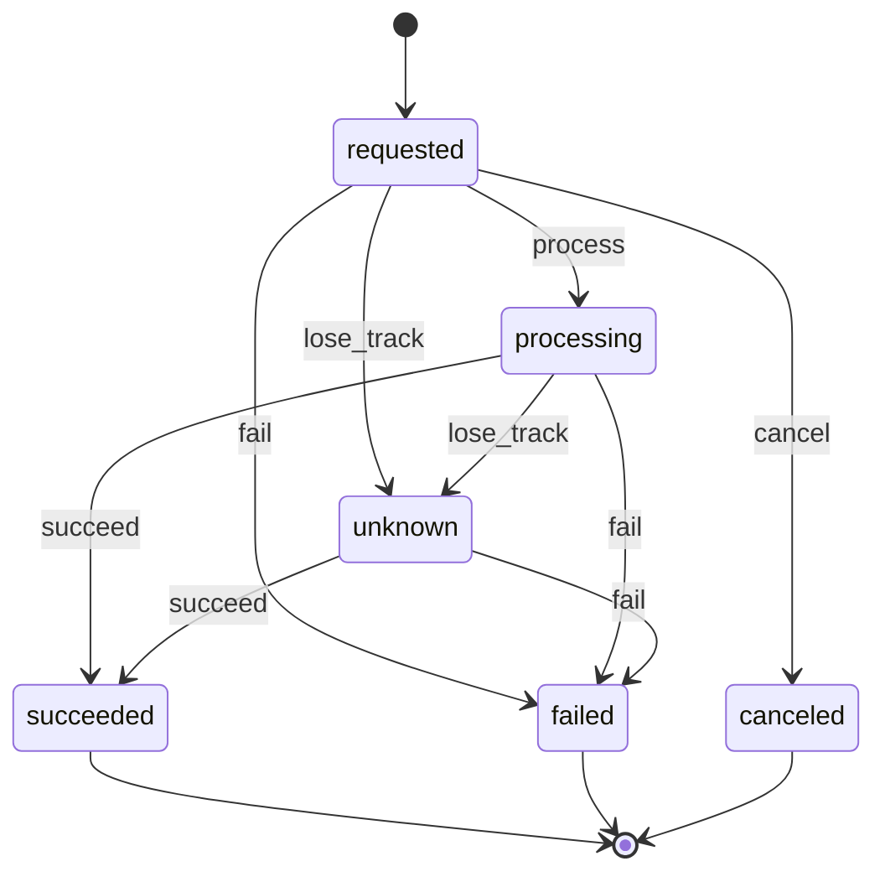

### 6.8 Checkout (`CheckoutMachine`)

Initial `prepared`; terminal `completed`, `compensated`, `aborted`. Provider success followed by local finalization failure stays visible as `recovery_required` (received money plus incomplete fulfillment, §4.11).

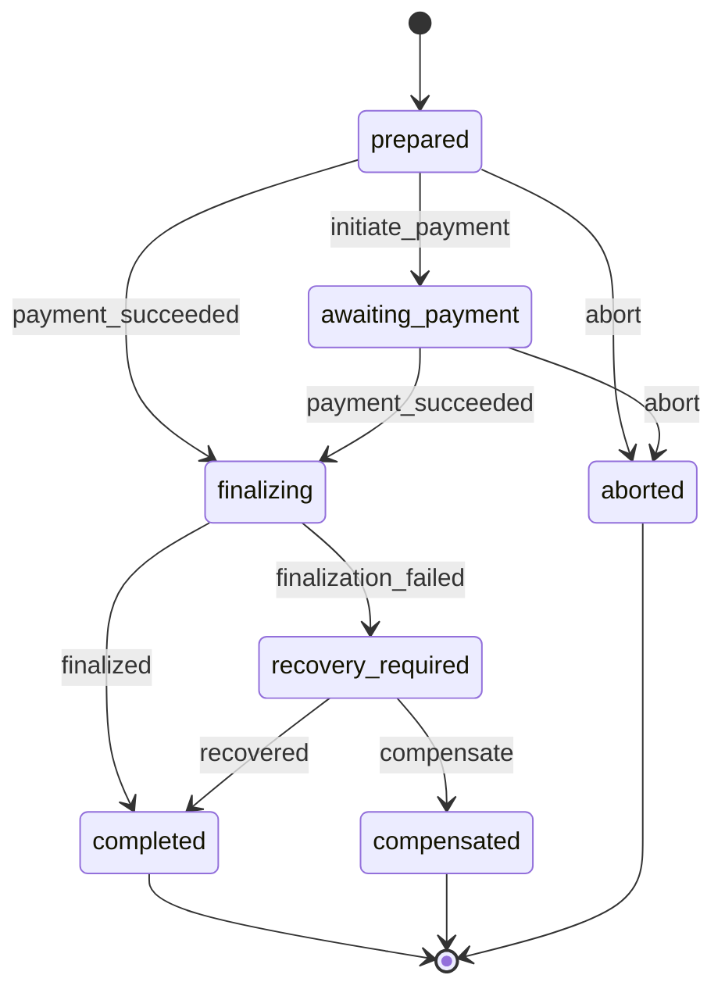

### 6.9 Result (`ResultMachine`)

Initial `draft`; terminal `superseded`. `official` has no backward transition: a correction is a new revision that supersedes this one (SPK-RESULT-001, SPK-RESULT-004).

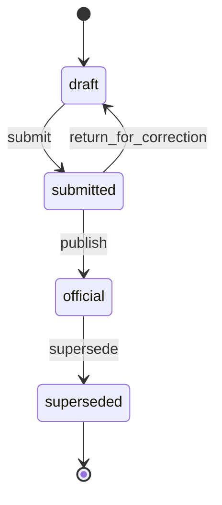

### 6.10 Assignment (`AssignmentMachine`)

Initial `proposed`; terminal `declined`, `withdrawn`, `completed`. A proposed assignment does not satisfy a required accepted-official check (SPK-STAFF-002).

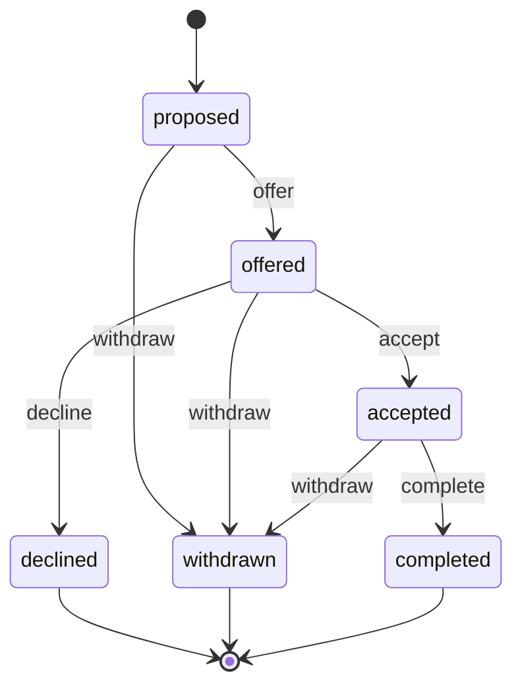

### 6.11 Module and kernel lifecycles that exist today (not in the §4.6 table)

These are **Verified** lifecycles defined beside the module that owns them, with the same `defineStateMachine` helper or an equivalent allowed-transition table, and listed by the database check constraints.

| Record                | Defined in                                                                                | Initial      | Transitions (from: event → to)                                                                                                                                                                                                                                                                                                                                                           | Terminal                       | Test                                                                                                                                                                                                                                      |
| --------------------- | ----------------------------------------------------------------------------------------- | ------------ | ---------------------------------------------------------------------------------------------------------------------------------------------------------------------------------------------------------------------------------------------------------------------------------------------------------------------------------------------------------------------------------------- | ------------------------------ | ----------------------------------------------------------------------------------------------------------------------------------------------------------------------------------------------------------------------------------------- |
| Invitation            | `apps/api/src/modules/identity/identity.machines.ts` (`InvitationMachine`)                | `pending`    | pending: accept → accepted, revoke → revoked, expire → expired                                                                                                                                                                                                                                                                                                                           | accepted, revoked, expired     | `identity.machines.spec.ts` "invitations and claims leave pending exactly once"                                                                                                                                                           |
| Claim                 | `identity.machines.ts` (`ClaimMachine`, same transitions as Invitation)                   | `pending`    | as Invitation                                                                                                                                                                                                                                                                                                                                                                            | accepted, revoked, expired     | `identity.machines.spec.ts`                                                                                                                                                                                                               |
| Relationship          | `identity.machines.ts` (`RelationshipMachine`)                                            | `active`     | active: suspend → suspended, end → ended; suspended: reinstate → active, end → ended                                                                                                                                                                                                                                                                                                     | ended                          | `identity.machines.spec.ts` "relationships can be suspended and reinstated but never leave ended"                                                                                                                                         |
| StaffMembership       | `identity.machines.ts` (`StaffMembershipMachine`)                                         | `active`     | active: end → ended                                                                                                                                                                                                                                                                                                                                                                      | ended                          | `identity.machines.spec.ts`                                                                                                                                                                                                               |
| AccessReview          | `identity.machines.ts` (`AccessReviewMachine`)                                            | `open`       | open: escalate → escalated, decide → decided, close → closed; escalated: decide → decided, close → closed; decided: close → closed                                                                                                                                                                                                                                                       | closed                         | `access-reviews.spec.ts` "state machine: open → escalated → decided → closed"                                                                                                                                                             |
| DuplicateCandidate    | `identity.machines.ts` (`DuplicateCandidateMachine`)                                      | `open`       | open: merge → merged, dismiss → dismissed                                                                                                                                                                                                                                                                                                                                                | merged, dismissed              | `duplicates.spec.ts`                                                                                                                                                                                                                      |
| Event (scheduling)    | `apps/api/src/modules/scheduling/scheduling.state-machines.ts` (`EventMachine`)           | `draft`      | draft: publish → published, cancel → canceled; published: cancel → canceled                                                                                                                                                                                                                                                                                                              | canceled                       | `schema-invariants.spec.ts` "check constraints list exactly the lifecycle states"; `events.spec.ts`                                                                                                                                       |
| Closure               | `scheduling.state-machines.ts` (`ClosureMachine`)                                         | `pending`    | pending: apply → active, withdraw → withdrawn; active: lift → lifted                                                                                                                                                                                                                                                                                                                     | lifted, withdrawn              | `closures.spec.ts`                                                                                                                                                                                                                        |
| ScheduleDraft         | `scheduling.state-machines.ts` (`ScheduleDraftMachine`)                                   | `editing`    | editing, validated and failed each: edit → editing, validate → validated, publish → publishing, fail → failed, discard → discarded; publishing: commit → published, fail → failed                                                                                                                                                                                                        | published, discarded           | `schedule-drafts.spec.ts` "lifecycle: discard, and terminal drafts refuse further commands"                                                                                                                                               |
| OfferingPublication   | `apps/api/src/modules/catalog/catalog.state-machines.ts` (`OfferingPublicationMachine`)   | `draft`      | draft: publish → published, archive → archived; published: open_registration → registration_open, close → closed; registration_open: pause_registration → registration_paused, close → closed; registration_paused: resume_registration → registration_open, close → closed; closed: archive → archived                                                                                  | archived                       | `catalog.state-machines.spec.ts` "SPK-CAT-004: publication, registration and closure are distinct steps; archive is terminal"; `offerings.spec.ts`                                                                                        |
| PolicyVersion         | `catalog.state-machines.ts` (`PolicyVersionMachine`)                                      | `draft`      | draft: approve → approved; approved: retire → retired                                                                                                                                                                                                                                                                                                                                    | retired                        | `catalog.state-machines.spec.ts` "§4.4 PolicyVersion: draft → approved → retired, nothing else"; `catalog-schema.spec.ts` (trigger)                                                                                                       |
| Program               | `catalog.state-machines.ts` (`ProgramMachine`)                                            | `draft`      | draft: activate → active, archive → archived; active: archive → archived                                                                                                                                                                                                                                                                                                                 | archived                       | `catalog.state-machines.spec.ts` "programs, sessions and discounts have the documented lifecycles"                                                                                                                                        |
| OfferingSession       | `catalog.state-machines.ts` (`OfferingSessionMachine`)                                    | `scheduled`  | scheduled: cancel → canceled, complete → completed (`complete` has no command yet; catalog README "Known gaps")                                                                                                                                                                                                                                                                          | canceled, completed            | `catalog.state-machines.spec.ts`; `offerings.spec.ts` "§4.4 Session ..."                                                                                                                                                                  |
| Discount              | `catalog.state-machines.ts` (`DiscountMachine`)                                           | `draft`      | draft: activate → active, retire → retired; active: retire → retired                                                                                                                                                                                                                                                                                                                     | retired                        | `catalog.state-machines.spec.ts`; `pricing.spec.ts` "SPK-PAY-003: finance defines discounts; codes are unique; revisions and lifecycle are enforced"                                                                                      |
| MaintenanceTask       | `apps/api/src/modules/facilities/facilities.state-machines.ts` (`MaintenanceTaskMachine`) | `open`       | open: assign → assigned, start → in_progress, resolve → resolved, close → closed; assigned: assign → assigned, unassign → open, start → in_progress, resolve → resolved, close → closed; in_progress: assign → in_progress, unassign → in_progress, resolve → resolved, close → closed; resolved: assign → resolved, close → closed, reopen → in_progress, fail_inspection → in_progress | closed                         | `facilities.state-machines.spec.ts` "SPK-FAC-002: a task moves open → assigned → in_progress → resolved → closed and closed is final", "SPK-FAC-004: a failed inspection sends a resolved task back to work; unassigning returns to open" |
| Restriction           | `facilities.state-machines.ts` (`RestrictionMachine`)                                     | `proposed`   | proposed: approve → approved; approved: activate → active; active: release → released                                                                                                                                                                                                                                                                                                    | released                       | `facilities.state-machines.spec.ts` "SPK-FAC-003/004: a restriction is proposed, approved, activated and released exactly in that order"; `schema-invariants.spec.ts` "check constraints list exactly the lifecycle states (§4.6)"        |
| Asset                 | `facilities.state-machines.ts` (`AssetMachine`)                                           | `in_service` | in_service: restrict → restricted, take_out_of_service → out_of_service, retire → retired; restricted: return_to_service → in_service, take_out_of_service → out_of_service, retire → retired; out_of_service: return_to_service → in_service, restrict → restricted, retire → retired                                                                                                   | retired                        | `facilities.state-machines.spec.ts` "SPK-FAC-001: asset and schedule status requests map to machine events"                                                                                                                               |
| PreventiveSchedule    | `facilities.state-machines.ts` (`PreventiveScheduleMachine`)                              | `active`     | active: pause → paused, end → ended; paused: resume → active, end → ended                                                                                                                                                                                                                                                                                                                | ended                          | `facilities.state-machines.spec.ts`; `preventive-schedules.spec.ts` "a paused or ended schedule generates nothing; status and revision are guarded"                                                                                       |
| Operation (kernel)    | `apps/api/src/kernel/operations/operations.service.ts` (`transition`, `TERMINAL`)         | `pending`    | any non-terminal status → any status (`pending`, `running`, `succeeded`, `failed`, `recovery_required`, `compensated`); a terminal status refuses every transition with `INVALID_TRANSITION`                                                                                                                                                                                             | succeeded, failed, compensated | `auth-and-operations.spec.ts` "operation transitions follow the lifecycle and terminal states are final"                                                                                                                                  |
| OperationalException  | `apps/api/src/kernel/exceptions/operational-exceptions.service.ts` (`allowed`)            | `open`       | open → acknowledged, resolved, closed; acknowledged → resolved, closed; resolved → closed                                                                                                                                                                                                                                                                                                | closed                         | `unit-of-work.spec.ts` "exceptions deduplicate while open, transition with authorization and revision checks"                                                                                                                             |
| Outbox event (kernel) | `0001_core_schema.sql` `outbox_events.status`; `outbox-dispatcher.ts`                     | `pending`    | pending → dispatched (every handler succeeded), pending → pending with a later `available_at` (retry), pending → dead (after `max_attempts`)                                                                                                                                                                                                                                             | dispatched, dead               | `outbox.spec.ts`                                                                                                                                                                                                                          |
| Inbox event (kernel)  | `0001_core_schema.sql` `inbox_events.status`; `inbox.ts`                                  | `received`   | received or failed → processed, failed (retry), dead (after ten attempts); `ignored` is listed by the check constraint and not yet written by any code path                                                                                                                                                                                                                              | processed, dead, ignored       | `inbox.spec.ts`                                                                                                                                                                                                                           |

## 7. The chains the specification names, hop by hop

Each row states what is true today and what is proposed, with the integrity rule that protects the hop.

| Chain (§4.4 and task wording)                                      | Hops and status                                                                                                                                                                                                                                                                                                                                                                                                                                                                                                                                                                                                                                                                                                                                                                                               |
| ------------------------------------------------------------------ | ------------------------------------------------------------------------------------------------------------------------------------------------------------------------------------------------------------------------------------------------------------------------------------------------------------------------------------------------------------------------------------------------------------------------------------------------------------------------------------------------------------------------------------------------------------------------------------------------------------------------------------------------------------------------------------------------------------------------------------------------------------------------------------------------------------- |
| Person, account                                                    | **Verified**: `accounts.person_id` nullable until claimed; one active account per person; `(issuer, subject)` unique; recovery relinks without new access (SPK-AT-025, `claims-and-accounts.spec.ts`).                                                                                                                                                                                                                                                                                                                                                                                                                                                                                                                                                                                                        |
| Household, relationship, access grant                              | **Verified**: households are grouping only; a relationship carries no permission; each permission is one `access_grants` row with its own effective window; revocation applies on the very next check (`relationships.spec.ts` SPK-IAM-006). **Proposed**: communications re-evaluates unsent protected notices on `identity.access_grant_revoked` (SPK-AT-017).                                                                                                                                                                                                                                                                                                                                                                                                                                              |
| Program, offering, session                                         | **Verified** (catalog, 2026-10-24): `programs` are reusable; an `offerings` row is dated, carries its registration window separately from `publication_state` (SPK-CAT-004, `offerings.spec.ts`) and cites its policy versions, entitlement definition and `price_rules`; an `offering_sessions` row is one dated unit (`offerings.spec.ts` "§4.4 Session ..."). Copying creates a draft and never copies price rules, payments, attendance, enrollments, results or permissions (SPK-CAT-003, `offerings.spec.ts`). **Proposed**: the link between a session and the scheduling event that reserves its space (`offering_sessions.scheduling_event_id` is a plain uuid the caller may supply; `events.source_type = 'session'` is the reverse column), which no command populates from the catalog side yet. |
| League, season, division, team, team entry, roster membership      | **Proposed** (competition): a team is continuing identity; a team entry is that team in one season (and, once placed, one division); roster memberships are effective-dated so last week's match keeps its roster (SPK-COMP-005). Renewal creates new season records (SPK-COMP-001, SPK-AT-003). Captain authority is the `teamRole: 'captain'` check on the `team_entry` target (**Verified** kernel path, `authorization.spec.ts`; competition registration **Proposed**).                                                                                                                                                                                                                                                                                                                                  |
| Fixture, result revision, standings                                | **Proposed** (competition): a fixture is a division game between two team entries whose time and field is a scheduling event (`source_type = 'fixture'`); result revisions follow `ResultMachine` (**Verified**) with each correction superseding the prior official revision; standings are a projection over official results and a rule set version (SPK-RESULT-001/003/004). A correction touching a published bracket raises a management review (`operational_exceptions`, **Verified** mechanism).                                                                                                                                                                                                                                                                                                     |
| Resource, configuration, conflict unit, event, reservation         | **Verified** (scheduling): a resource maps to one or more conflict units; a configuration names which resources may run simultaneously; an event holds one reservation per resource and one reservation unit per conflict unit for the occupied interval (scheduled plus buffers); the GiST exclusion rejects the second overlapping unit (`schema-invariants.spec.ts`, `schedule-drafts.spec.ts` SPK-AT-008).                                                                                                                                                                                                                                                                                                                                                                                                |
| Asset, maintenance task, inspection, restriction, closure          | **Verified** (facilities, 2026-10-24): a task names an asset or a space; approving a restriction records the authority, creates a scheduling `closures` row through the closure port and activates with the affected conflict units, so a half-pitch restriction blocks that half and the whole pitch while the other half stays bookable; closing the task never reopens the area; release needs `facilities.release_to_service` and, when required, a passed inspection, and lifts the closure (`restrictions.spec.ts` SPK-AT-021, SPK-FAC-003/004). A closure lifted directly in scheduling is surfaced as an operational exception, never applied silently.                                                                                                                                               |
| Application, enrollment, placement                                 | **Proposed** (enrollment): approval, enrollment, placement and financial obligation are independent records (SPK-REG-003); an accepted application yields enrollments; a placement request hangs off an individual enrollment and is assigned to a team entry only after capacity and eligibility are checked at commitment (SPK-PLACE-003). Lifecycles **Verified** (sections 6.1 to 6.3).                                                                                                                                                                                                                                                                                                                                                                                                                   |
| Capacity pool, hold, allocation, waitlist                          | **Proposed** (enrollment): a pool counts active holds plus allocations against its limit (SPK-REG-005); a hold is server-owned with one terminal outcome (**Verified** machine, section 6.4) and becomes an allocation on commit; a waitlist offer is backed by a hold so acceptance consumes it once and expiry releases it by the priority policy (SPK-REG-008); a late payment never displaces a valid offer (SPK-AT-006). The counting constraint is the mechanism for §4.7 invariant 3.                                                                                                                                                                                                                                                                                                                  |
| Quote, order, obligation, payment attempt, refund, credit, journal | **Proposed** (finance): a stored quote (expiring, with policy references) converts to an order whose lines keep their participant, entitlement, price and outcome; obligations split what is due now from future installments and team liabilities; a checkout (**Verified** machine, section 6.8) creates the durable `operations` row (**Verified**) and drives payment attempts; refunds reserve funds first; credits redeem at most once; every money fact is an append-only journal entry. §4.7 invariants 5, 6, 7.                                                                                                                                                                                                                                                                                      |
| Trigger event, notification, delivery attempt                      | **Proposed** (communications): a notification is created by an outbox handler from a domain event (`outbox_events.id` is the trigger reference, **Verified** envelope); recipients are resolved from current grants and rechecked before external handoff (SPK-COMMS-003); each channel attempt records the SPK-COMMS-004 state. The event catalogue is in `docs/architecture/api-and-events.md` section 9.                                                                                                                                                                                                                                                                                                                                                                                                   |
| Operation, outbox event, job attempt, operational exception        | **Verified** (kernel): a multi-step command creates an operation; follow-ups are outbox events in the same transaction; each handler run is a job attempt; dead letters become owned operational exceptions (`outbox.spec.ts`, `inbox.spec.ts`).                                                                                                                                                                                                                                                                                                                                                                                                                                                                                                                                                              |

## 8. Pending decisions that change the shape of this model (owners from §6.6)

Nothing in this table is answered in the repository (`docs/package-a/decision-register.md`, "every record ... has answer status unknown"). The model above is built so that each answer changes vocabularies and values, not table structure.

| Decision (§6.6 row)                                | Owner (§6.6)                  | Register id                        | Entities whose vocabulary or constraints depend on it                                                          | Status               |
| -------------------------------------------------- | ----------------------------- | ---------------------------------- | -------------------------------------------------------------------------------------------------------------- | -------------------- |
| Actual facilities, spaces, subdivisions, hours     | Operations                    | DEC-001                            | Resource, Configuration, ConflictUnit, OperatingHours and `assets` rows; the restriction approval rule         | **Pending decision** |
| Soccer formats and competition rules               | League manager                | DEC-002                            | CompetitionRuleSetVersion, Division criteria, RosterMembership roles, Fixture constraints, Suspension scope    | **Pending decision** |
| Youth eligibility, capacity, staffing, progression | Program manager               | DEC-003                            | Offering eligibility, CapacityPool staffing requirement, Assessment templates, MakeupEntitlement limits        | **Pending decision** |
| Guardian verification and child-account policy     | Operator/privacy owner        | DEC-004                            | Relationship `source`, Claim and Invitation flows, whether a child Person may hold an Account                  | **Pending decision** |
| Pickup and outage procedure                        | Operations                    | DEC-005                            | ReleaseRecord verification outcomes, AttendanceObservation offline fields, offline roster age (DEC-033)        | **Pending decision** |
| Waitlist, holds, approvals, basket behavior        | Product and operations        | DEC-006, DEC-026, DEC-027, DEC-028 | Hold expiry, WaitlistEntry priority basis, WaitlistOffer expiry, Order fulfillment mode, Approval requirements | **Pending decision** |
| Prices, taxes, discounts, rounding                 | Finance                       | DEC-007                            | `price_rules` and `discount_definitions` values; QuoteLine amounts                                             | **Pending decision** |
| Team liability, installments, overpayments         | Finance and league manager    | DEC-008                            | Obligation responsible party, InstallmentPlan, PaymentAllocation overpayment handling                          | **Pending decision** |
| Refunds, credits, transfers, cash                  | Finance                       | DEC-009                            | RefundAttempt rules, Credit permitted uses and expiry, Enrollment transfer charges, cash JournalEntry kinds    | **Pending decision** |
| Discipline and appeals                             | League manager/operator       | DEC-010                            | DisciplinaryDecision rules, Suspension basis and applicable competitions, Appeal process                       | **Pending decision** |
| Official qualifications and fees                   | Operations/finance            | DEC-011                            | Qualification kinds, FeeSubmission rate basis and approver                                                     | **Pending decision** |
| Public information and communication policy        | Operator/privacy owner        | DEC-012, DEC-062                   | Preference categories, which triggers produce external DeliveryAttempts, StandingsProjection visibility        | **Pending decision** |
| Providers and production accounts                  | Technical lead/account owners | DEC-018, DEC-019, DEC-020          | Account issuer, PaymentAttempt and DeliveryAttempt provider fields, InboxEvent providers                       | **Pending decision** |
| Migration scope and writer authority               | Migration owner/operator      | DEC-014                            | AuthorityAssignment rows, ExternalMapping source systems                                                       | **Pending decision** |
| Conditional capability applicability               | Product owner                 | DEC-016                            | Offering kinds rental, package, membership, party, tournament; InstallmentPlan; POS and accounting entities    | **Pending decision** |
| Result publication authority                       | League manager (per DEC-065)  | DEC-065                            | Who may fire `publish` on `ResultMachine`                                                                      | **Pending decision** |

## 9. Replacing the demonstration shortcuts (§4.5)

The local demonstration is not in this repository, so its types cannot be quoted; the rows restate §4.5 and say how this model answers each item.

| §4.5 statement                                                         | Treatment in this model                                                                                                                                     | Status                                                                                                                                                                   |
| ---------------------------------------------------------------------- | ----------------------------------------------------------------------------------------------------------------------------------------------------------- | ------------------------------------------------------------------------------------------------------------------------------------------------------------------------ |
| `Person.householdId` cannot determine authority                        | Households are a grouping table; authority is only an `access_grants` row                                                                                   | **Verified** (`staff-memberships.spec.ts` "§4.5: household membership never grants authority")                                                                           |
| A stored `age` cannot replace date-based eligibility evaluation        | `persons.date_of_birth` is stored; `kind` must agree with it; eligibility is evaluated by the enrollment module against a policy version and reference date | **Verified** for the person record (`people.spec.ts` "§4.5: the declared kind must agree with the date of birth"); **Proposed** for eligibility evaluation (SPK-REG-002) |
| `Resource` must express physical overlap and configurations            | `conflict_units`, `resource_conflict_units`, `resource_configurations`                                                                                      | **Verified** (`schema-invariants.spec.ts`, `resources.spec.ts`)                                                                                                          |
| `Offering.priceCents` must become versioned price rules and quotes     | `price_rules` versions (immutable, one effective per instant) and a Quote with retained price basis per line                                                | **Verified** price rules (section 4.4; `pricing.spec.ts` SPK-PAY-001/002); Quote **Proposed** (section 5.3); `Money` contract **Verified**                               |
| Enrollment must not combine confirmation and waitlisting in one status | `EnrollmentMachine` has no waitlist state; WaitlistEntry and WaitlistOffer are separate records                                                             | **Verified** machine; **Proposed** records                                                                                                                               |
| Payment must not reduce provider outcomes to only paid/refunded        | `PaymentAttemptMachine` and `RefundMachine` with `action_required`, `processing`, `unknown`                                                                 | **Verified** machines; **Proposed** records                                                                                                                              |
| Team must separate continuing identity from season entry               | Team and TeamEntry                                                                                                                                          | **Proposed** (section 5.1)                                                                                                                                               |
| Attendance must preserve observations and corrections                  | AttendanceObservation rows with `corrects_observation_id`, never updated in place                                                                           | **Proposed** (section 5.4); append-only trigger pattern **Verified**                                                                                                     |
| Coach names must become person and assignment references               | Assignment references `persons.id`; `event_commitments.party_id` for overlap                                                                                | **Proposed** (section 5.4); `event_commitments` **Verified**                                                                                                             |
| Messages must represent actual delivery states                         | DeliveryAttempt state per channel (SPK-COMMS-004)                                                                                                           | **Proposed** (section 5.4)                                                                                                                                               |
| Global bootstrap responses must give way to scoped, paginated queries  | `PageRequestSchema` and cursor pages; organization scope from the principal                                                                                 | **Verified** (`packages/contracts/src/pagination.ts`; `events.spec.ts` "cursor pagination")                                                                              |
| Existing clients must be migrated together with contract tests         | No demonstration client is in this repository; parity tests (§4.1) cannot be written until it is added                                                      | **Pending decision**: Migration owner/operator (DEC-014), and the demonstration must be supplied                                                                         |

## 10. Specification ambiguities encountered

1. §4.4 lists "Acknowledgment" twice, under Policies and under Communications. This document treats them as two entities (a guardian acknowledging a policy version versus a recipient acknowledging a notice, SPK-COMMS-004) and names the second `CommsAcknowledgment` in the diagram.
2. §4.4 "Approval" (Policies) has no owning module in §4.2. It is placed with catalog ("policies") as a record type, while the commands that require an approval live in enrollment (SPK-REG-002, SPK-REG-007), finance (SPK-STAFF-006 approver, SPK-PAY-008), competition (SPK-DISC-002) and workforce. The alternative, an approval column on each target, was rejected because §4.6 requires actor, guards and recovery per command and §4.14 requires audited privileged actions.
3. §4.4 "Configuration" (Scheduling) and §4.5 "configurations" are read as the same thing: the named physical arrangement that `resource_configurations` implements (SPK-SCHED-002).
4. §4.4 "Exception" (Operations) is implemented in the kernel as `operational_exceptions`, while §4.2 gives "Cases and operational task coordination" to the support module. This document keeps the record in the kernel (every module raises exceptions) and the workflow in support, as the support README states.
5. §4.4 does not list the entities the specification elsewhere requires (Invitation, Claim, StaffMembership, AccessReview, Closure, EventSeries, EventCommitment, Publication, TeamInvitation, FixtureAvailability, Dispute, MakeupEntitlement, Assessment, InstallmentPlan, QuoteLine, CreditRedemption, Pass, Audience, CalendarFeedAuthorization, MetricDefinition). They are included and marked with the requirement that demands them; "Minimum domain entities" is read as a floor, not a ceiling.
6. §4.6 "Session booking" has `confirmed` as a non-terminal state with only `cancel`, and no `complete` event, unlike Enrollment. The contract reproduces §4.6 literally; whether a session booking should complete is left to the enrollment module design (**Proposed** to leave as is).
7. The workflow assignment for this document described only the kernel tables as existing ("Mark the kernel tables that exist today as Verified ... and all others Proposed"). On 2026-10-24 the identity (0100), catalog (0200), scheduling (0300) and facilities (0900) migrations exist with schema files and tests, so their tables are marked **Verified** with citations; marking them Proposed would misstate the repository. The catalog and facilities migrations landed while this document was being written (the module build workflow runs in parallel), so sections 3, 4 and 6.11 are a snapshot of that date.
8. §6.6 names "Program manager" for youth decisions but the specification has no standalone row for "Result publication authority" (SPK-STAFF-005, SPK-RESULT-001); the decision register's DEC-065 assigns it under the League manager row, and this document follows the register.
9. §4.4 names "Approval" once; the catalog migration realises it as an append-only `approvals` table whose `subject_type` admits only `policy_version` and `offering_publication`. The approvals the specification requires elsewhere (SPK-REG-002 overrides, SPK-REG-007 approval before payment capture, SPK-DISC-002, SPK-STAFF-006) are therefore still **Proposed**, either as new `subject_type` values on this table or as records owned by the deciding module. Ambiguity 2 is kept for the record: the table settles where the record lives, not how far it reaches.
10. §4.4 lists "Session" under Catalog and "Event" under Scheduling without saying which side owns the link between them. Today `offering_sessions.scheduling_event_id` is a plain uuid the caller may supply and `events.source_type`/`source_id` exist on the scheduling side; no code populates either from the catalog. Both columns are **Verified**; the link itself is **Proposed**.
